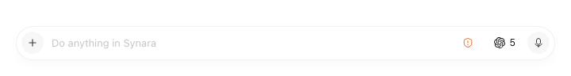
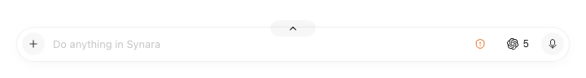
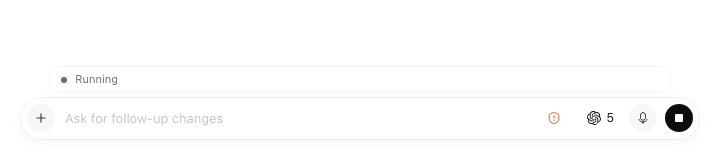
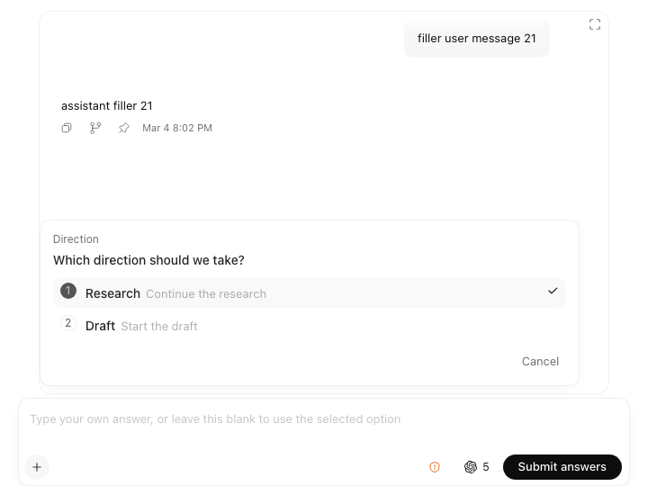
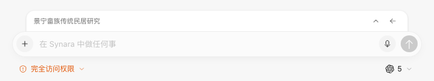
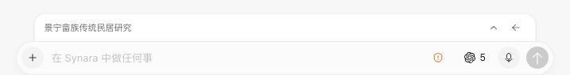
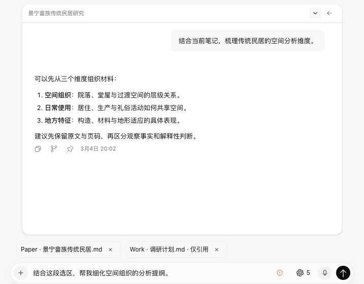

# Zen mode UI evidence

These browser-fixture captures use synthetic chat and Obsidian context. They demonstrate the user-approved layout, not a production profile, live provider response, or native-window acceptance.

## 2026-11-07 refinement

The refinement removes the permanent title rail and outer backing surface, places a hover/focus disclosure grip at the composer upper edge and the paired restore icon at the open drawer upper right, and shows a bottom drag grip on hover. Goal, Plan, approvals and questions reuse their existing owners in the upward drawer. A collapsed running or attention state gets one summary strip; expanded content supplies the detail.

Browser captures flatten transparent pixels onto a white page. The separate isolated macOS Electron smoke checks renderer alpha, native shadow and material handling, production preload/IPC, pointer reset, workspace settings, window geometry and restoration. Its same-process synthetic fullscreen host does not establish cross-application fullscreen z-order; physical mouse dragging remains a manual check. These captures do not imply the installed application was updated.

## Earlier merged layout

| Previous preview                                           | Accepted compact layout                                                   |
| ---------------------------------------------------------- | ------------------------------------------------------------------------- |
|  |  |

The same editor and menus remain mounted. Zen moves the permission and model triggers inside the composer; narrow windows hide the model text while retaining its title and menu. Opening menus temporarily reserves native window space without opening the transcript.

[Watch the interaction recording](interaction.webm) — 12.3 seconds, 720 × 600, silent WebM (about 89 KiB). It shows compact mode → permission menu → expanded conversation → compact mode, with the same editor retained.

Recorded from Chromium with Playwright using the existing synthetic Chinese Zen preview fixture. A temporary capture-only Vitest configuration added pauses and the final collapse; FFmpeg trimmed startup/cleanup and encoded the video without changing the recorded sequence. The recording canvas remains fixed while the fixture viewport changes. Native frame resizing, always-on-top, global shortcuts, and live provider responses are outside this browser recording; no real user profile or notes were used.

Implementation and actual checks: [Zen acceptance record](../../../context/zen-mode-implementation-2026-11-06.md).
