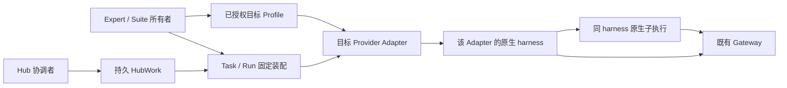

# Expert、Suite 与四端原生委派 — 架构主干

## 设计范式

**沿用端口与适配器。** Expert/Suite 所有者固定业务配置，Provider Adapter 根据执行用途投影，harness 执行。四端共用绑定、授权和验收语义，不共用原生子执行协议，不引入统一子 Agent 运行器。

## 继承与修订范围

- 现有 initiative `initiative-expert-suite-hub` 与 2026-11-13 主干来自主 checkout 的 BMad 产物；项目中的[既有契约](../expert-product-technical-design.md#2026-11-13-后续架构修订入口)登记了该主干的路径和适用范围。
- 保留原主干 AD-7/8、AD-12/13、AD-17–20 的对象、授权、生命周期、子级 Skill 作用域和切换规则。原 AD-15 的「Pi 永不建设原生子 Agent」改为「列入目标，上游提供内置接口并验收后开放」；不改变其公开接口、Skill 文本后备与禁止模拟执行的约束。下面是本增补自己的 AD 编号。
- 本文冻结方案和边界。初始实现仅 OMP；当前源码和证据见下文[实施记录](#实施记录)。当前 OMP 专用补丁的既有证据不能验收新公开接口。

## 不变量与规则

### AD-1 — 三种能力独立准入 [ADOPTED]

- **Binds:** 独立 Expert、Suite、同 harness 原生 Expert 委派。
- **Prevents:** 把能执行根任务、能加载 Suite 或能启动普通子代理误当成可信委派；Pi 上游缺口阻塞无关能力。
- **Rule:** 分别判定独立 Expert、Suite、原生 Expert 委派；Suite 再区分协调者和专业任务/worker 的执行用途。保存/选择/派发使用同一静态支持规则，运行前在实际 Provider 实例与版本上核对所请求的能力。不可用应拒绝受影响动作，不能静默换 Provider/model、退为普通任务或写入不可逆 Hub Suite 锁。静态菜单可选不等于运行证明。

### AD-2 — Suite 复用原 Run；跨 harness 只走 HubWork [ADOPTED]

- **Binds:** Suite 直属任务、Hub 协调者、四端 worker、恢复。
- **Prevents:** 套件或 Adapter 绕过资源所有者、从当前模板重建旧工作、按协调者 harness 派所有 worker。
- **Rule:** 保留首次发送固定的 Expert/Suite 绑定、Hub 模式锁及真实 `rootRunId`。已有装配所有者解析并校验角色与 Run 内容；Adapter 只投影已验证的同一 binding、assembly、配置及资源。使用现有 `suiteApplication` 比对投影，不能用请求字段回显作为生效证明；缺失或不一致拒绝该 Run。协调者不伪造专业 Expert 快照；worker 固定其目标 Expert 和有效工具，停止、恢复及补充指令继续使用原工作与原装配。混合运行以 `HubWork` 创建/继续目标 worker；一个 Hub 的协调者与 worker 可使用不同 harness，其结果仍走原 HubWork/成果关系。

### AD-3 — 独立 Expert 与专业 worker 保留固定边界 [ADOPTED]

- **Binds:** 四端固定 Skill、参考资料、MCP、停止与恢复。
- **Prevents:** 为套件或子 Agent 扩大父 Skill 列表、给根任务换成文本近似、把新的模板或凭据装入旧任务。
- **Rule:** 绑定记录和 Run 固定装配是权威。每个 Adapter 按固定策略核对实际生效的目录/入口、内容与当前生命周期代次。Gateway 按验证过的根会话及固定连接范围授权；全局撤权仍实时生效。启动或恢复时不能证明应用的固定装配则拒绝，不以跳过检查或根级文本替代达成四端统一。父加载策略不因委派而修改；只在子级按继承的 AD-19 放宽允许发现的范围。

### AD-4 — 同 harness 原生委派必须证明选中身份与真实子执行 [ADOPTED]

- **Binds:** 目标解析、子 Profile、原生执行和父结果。
- **Prevents:** 用模型自报 Expert ID 授权、把普通子代理或跨 harness 的独立任务伪装成原生执行。
- **Rule:** 从当前父运行的已授权 Expert 范围解析目标，按宿主映射固定身份、revision、方法与资源来源；真实原生 spawn/执行标识必须能与该映射关联，结果走 harness 的原生父子路径一次。跨 harness 请求只可由有权协调者显式走 HubWork，不由委派接口自动改派。子级能力只能来自父原生允许继承的授权范围；不附加目标独立连接或凭据。目标方法优先通过可证实的子级原生入口加载；若只有 Skill 加载不支持，才在原生子执行启动前用授权的准确路径按需读取；不得借文本绕过全局禁用，也不回退到自建子执行。

### AD-5 — 原生委派的公开接口与切换边界 [ADOPTED]

- **Binds:** Claude Code、Codex、OMP 的内置子执行；Pi 的开放条件；旧 OMP 委派迁移。
- **Prevents:** 将 Pi SDK 扩展计作内置委派，把既有私有 OMP 执行器复制给其他端，或由宿主重复推进原生子任务。
- **Rule:** 优先核对 Claude 自定义 Agent、Codex 自定义 Agent 和 OMP 公开 Task 接缝；每端真实证明目标身份、可用工具边界、完成/停止、结果回传及所宣告的恢复行为后才开放。Pi 核心未提供内置子 Agent；公开 SDK 能运行额外会话或加载扩展示例不是本项目的原生验收。Pi 原生委派保持不支持，直到上游公开发布内置路径并通过同一验收。保留 Pi 独立 Expert 和 Suite 的实施范围。子执行由 harness 推进；父自然回合结束不是取消，显式 Stop 撤权并用原生命周期停止，不能确认终态就记未知。三端新公开接入通过后按原 AD-20 一次性排空并退役旧执行路径；不把旧 OMP 记录变成可重放任务，也不要求等待 Pi 才能实施已成立的三端。

## 实施与证据门禁

1. **共用执行接缝：** 沿用 `ProviderService`、`RunSkillAssemblyStore`、Provider Adapter 和 Gateway。先用同一冻结 Expert/套件及有界 MCP 夹具证明独立运行，以及 Suite 根任务、协调者和 worker 的实际装配。每个版本都验证首次启动、明确停止、恢复原装配、错误回执拒绝和越权工具拒绝。不把 OMP allowlist 改成四端列表当作完成。
2. **混合 Hub：** 一个 Suite Hub 派发 Claude Code、Codex、Pi、OMP 各一个 worker；核对角色、目标 harness、固定版本、成果归属、恢复原 work ID、一端失败不影响其他工作及跨 Hub 拒绝。四端协调者分别验证同一派发工具边界；不要求测试全部 16 个组合。
3. **内置委派：** 每个可用端用一个父任务派发两个 Skill 集合不同的真实目标 Expert，核对原生身份、结果恰好一次、父目录不扩张、非授权目标/工具拒绝、父自然结束、Stop 以及晚结果。未通过或接口缺失就标明该能力不可用。Pi 未有上游证据前，禁止宣称四端原生完成。
4. **运维：** 每端登记真实运行组件版本、能力和正反结果；隔离 home、配置信息和测试资源，不修改日用安装。兼容性降级不改变权限边界。单独登记源码集成、真实 Provider、旧执行排空、安装与发布；诊断不保存提示词、文件内容、项目名或凭据。当前方案不授权改 UI、账户/模型、安装、发布或生产切换。

技术来源：[Claude 自定义子 Agent](https://code.claude.com/docs/en/sub-agents)、[Codex 自定义子 Agent](https://learn.chatgpt.com/docs/agent-configuration/subagents)、[Pi SDK](https://github.com/earendil-works/pi/blob/main/packages/coding-agent/docs/sdk.md)与[官方扩展示例](https://github.com/earendil-works/pi/tree/main/packages/coding-agent/examples/extensions/subagent)、[OMP 上游 Task 执行](https://github.com/can1357/oh-my-pi/blob/650f3a108229ee11bf68ba3377f4e8c3391cd424/packages/coding-agent/src/task/executor.ts)。架构不指定新最低版本；当前依赖以[服务端 manifest](../../apps/server/package.json)为准，实际支持阈值由每端公开接口验证确定。

## 实施记录

2026-11-23：Pi SDK 1.4.0 已接入 Suite 直属 Expert／worker 与协调者。服务端按用途准入，保留原 binding、Run 和 HubWork；协调者不加载 Expert 身份，也不从成员继承连接。Pi Adapter 使用 SDK 的固定资源装配，核对实际系统提示、Skill 目录与内容；协调者只装配只读工具和已授权的 Gateway 工具。缺失、错 Run 或错代次的回执拒绝执行。

- **验证边界：** 用真实 Pi SDK、替换模型传输的隔离测试，核对两个角色的系统提示、工具、Stop、恢复原装配和篡改拒绝。持久化夹具证明 OMP 协调者启动原 Pi work、Pi 协调者受理 OMP work，以及不支持的目标在受理前失败。这不是公网模型、四端混合 Hub 或真实成果端到端验收。
- **Claude Code：** Agent SDK 0.3.296 / CLI 2.1.296 可提交附加系统指令，但没有可在首回合前核验已生效内容的回执；恢复可能复用旧系统提示快照。保持 Suite 门禁关闭。
- **Codex：** CLI 0.170.0 能提交 `developerInstructions`；公开 `thread/start`、`thread/read` 和恢复协议未返回已生效指令或其哈希。现有原生 Skill 验证不证明完整 Suite 投影。保持 Suite 门禁关闭。
- **原生委派：** Claude 的公开 SDK 能把 Agent 类型、工具调用与实际 task ID 关联；Codex 能用子线程 ID 查角色，但它们尚未证明本方案所需的固定 Profile、生效范围与父会话授权。OMP 18.16.0 的公开 Task/扩展可观察子执行，未证明 ACP 下的 Gateway 代次关联与终态边界；因此未开启新路径，也未排空或退役旧 OMP。Pi 仍等待公开内置子 Agent。

## 延后事项

跨 harness 原生子委派不在范围；跨 Provider 迁移、Suite 来源扩展、UI 重构与模型选择保持既有契约。Pi 原生委派的下一次评估以公开的内置接口发布为条件；无 SDK 扩展或自建执行器替代方案。
