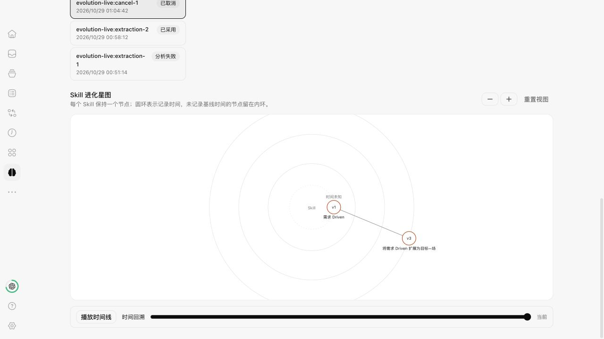
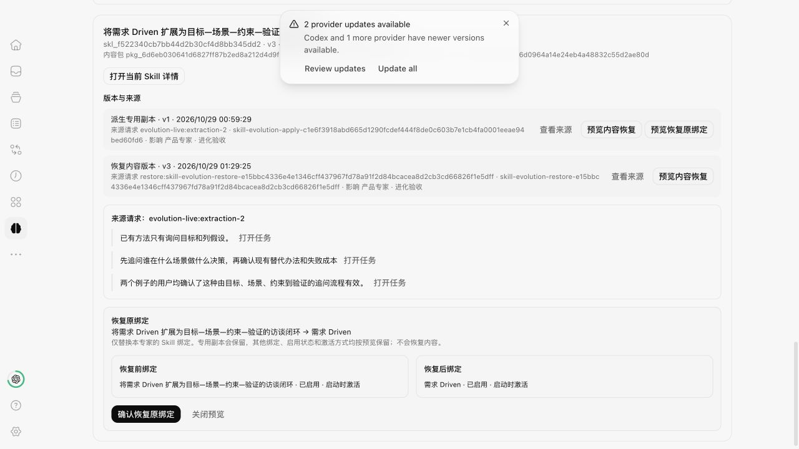

# Expert Skill 主动进化实现验收

日期：2026-10-29，Asia/Shanghai。状态：实现、首轮隔离预览验收及三项私密审查问题的修复复验均完成；未提交、合入、推送、打包或安装日用应用。授权来源：用户要求按已确认的产品方案和计划执行，并根据私密审查修复。真实 Provider/平台未验范围保留在下表。

范围依据：[产品方案](./expert-skill-evolution-product-plan-2026-10-28.md)、[研发方案](./expert-skill-evolution-technical-plan-2026-10-28.md)、[实施计划](./expert-skill-evolution-implementation-plan-2026-10-28.md)。源码基线 `9846774838274c45989a9dea3dcf1dc70de3af2b`，实施分支 `codex/expert-skill-evolution`。

## 实现范围

| 能力           | 实际实现与边界                                                                                                    |
| -------------- | ----------------------------------------------------------------------------------------------------------------- |
| 专家页进化入口 | 复用专家页签、草稿保护、模型选择器及原生任务链接；目标仅为当前专家已保存绑定，或明确新建专用 Skill                |
| 来源与提炼     | 选择 1–5 个已结束回合；保存准确消息和目标版本；模型只能返回候选内容与可核对引用，不能决定归属、策略或认可         |
| 策略           | 缺省受保护；共享更新同一身份；独立首次复制完整包并替换对应绑定，保留 enabled/activation；后续更新专用身份         |
| 采用和故障恢复 | 精确摘要认可、版本 CAS、稳定操作 ID、保存未绑定出口；持久采用 intent 重启后恢复，冲突不覆盖新配置                 |
| 文件与历史     | 支持文件、删除项、可执行位、完整基础内容与候选对照；待审基础包和历史采用包进入保留检查                            |
| 历史恢复       | 旧内容保存为新修订；首次派生可显式预览并恢复原绑定，保留副本；事件记录实际完成时刻                                |
| 专用转共享     | 扩展原 Skill 详情的范围/策略设置，沿用 owner、revision 和请求回执；保留派生来源，不自动绑定别人                   |
| 时间环星图     | 同一 Skill 一个节点，派生关系、缩放/拖动/播放、版本和证据详情；已删除 Skill 保留历史；无 Memory、使用分数或伪日期 |

主要业务入口：[Service](../apps/server/src/experts/evolution/SkillEvolutionService.ts)、[Prompt](../apps/server/src/experts/evolution/SkillEvolutionPrompt.ts)、[前端](../apps/web/src/workbench/features/expert-evolution/ExpertSkillEvolution.tsx)。宿主接入和覆盖范围见 [integration-points](../workbench/integration-points.json) 的 `expert.skill-evolution`。

## Provider 与隔离

| Provider    | 实现                                                                                                   | 本次实际验证                                                                                      |
| ----------- | ------------------------------------------------------------------------------------------------------ | ------------------------------------------------------------------------------------------------- |
| Pi          | 无工具、无扩展/环境 Skill/Context；临时中性 cwd、内存会话、不恢复原生会话                              | 真实 Pi SDK 0.87.1 和本机既有默认模型 `openai-codex/gpt-5.6-sol`；候选、采用、下一 Run 和取消通过 |
| Claude      | 空 tools/skills/plugins/MCP；自定义系统提示、无环境设置、无会话持久化；显式关闭 auto-memory/auto-dream | 适配器与 ProviderService 回归通过；未把真实 Claude 账号、网络执行或取消计为已验收                 |
| Codex / OMP | 提炼专用执行约束尚未完成验证                                                                           | 入口返回不支持原因，不自动改 Provider；普通任务能力保留                                           |

原生 Reactor 和 ProviderService 共同核验服务端持久登记。只传 `executionPurpose` 不能绕过普通 Context 校验；注册任务也不能从普通恢复或原生 fork 进入环境会话。提炼的最终模型输入排除 Hub Memory、项目目录说明、目标/调试附加文本和其他引用。专家配置、工具定义及记忆均不是本轮进化产物。

## 真实流程证据

本次使用独立预览中的合成访谈案例，真实调用模型；不复制日用聊天或用户项目文件。

| 场景           | 结果                                                                                                                                                               |
| -------------- | ------------------------------------------------------------------------------------------------------------------------------------------------------------------ |
| 原生来源工作   | `evolution-live-source` 的正常结束回合产生访谈方法，来源身份与具体用户/助手消息可核对                                                                              |
| 第一次失败     | `evolution-live:extraction-1` 在 ProviderService 普通 Context 门禁前被拒，未启动模型或产生 Skill；定位后补齐受登记限制的隔离校验，失败记录保留                     |
| 专用派生       | `evolution-live:extraction-2` 返回准确引用和候选；从实际页面点击采用，专家从 v2 更新到 v3                                                                          |
| 原版保留       | 来源 `skl_66d0964a14e24eb4a48832c55d2ae80d` 仍为 revision 1、包 `pkg_4376af4058c770f5a5da442f93a3df3c12cd5427313d4ed1895888eb75ca9196`                             |
| 首次专用版本   | `skl_f522340cb7bb44d2b30cf4d8bb345dd2`，包 `pkg_6d6eb030641d6827ff87b2ed8a212d4d9f1544a88fffec822a4161090c59aca8`，沿用 enabled=true / startup                     |
| 同会话下一 Run | 原 rootRun 保留来源包；`run:evolution-live-source:evolution-live:next-user` 新装配包含专用包，原生回执为 native-fixed、Pi SDK 0.87.1；未以装配回执声称业务效果提升 |
| 真实取消       | `evolution-live:cancel-1` 原生回合 `667c9b26-09bf-4cb7-86ac-34a28c56d31f` 从 running 到 cancelled，候选为 0                                                        |

页面还完成以下真实操作：

- 查看“当前版本 v2 vs 恢复目标”的完整对照并确认，专用 Skill 产生 revision 3，复用原 revision 1 的不可变内容包；本次基础 v2 包同时保留，旧包未改写。
- 预览专用→来源、启用及 startup 激活方式后确认恢复原绑定，Expert 为 v4，绑定回来源；专用 Skill revision 3 及 derived/restored/binding_restored 事件保留。
- 时间回放到首次派生时显示 v1，结束回到当前 v3。390/320 像素下文档与面板 scrollWidth 均等于 clientWidth，无横向溢出；验收后恢复默认视口。

本图记录本模块的正式采用和绑定回退事件。普通技能库编辑会递增修订，因此事件版本号可以跳号；不把未记录的手动修改补造为学习事件。

不运行模型的故障验证覆盖：受保护认可、共享同身份更新、完整独立派生、重复操作、绑定中断、真实 Expert revision 冲突、更新成功但事件写入失败、归档只读、原生启动拒绝、内容恢复、恢复绑定以及删除后的历史图。真实活跃双专家共享传播、真实 Claude 和 Windows/macOS 打包安装不由这些测试推定完成。

## 首轮实现的门禁与审查

共享影响名单固定到候选摘要，并在既有生命周期锁内的写入前校验；期间新增使用者会冲突，不能扩大原认可范围。迁移为 Expert ledger 10；官方迁移及冻结旧 111 不变。

| 门禁                                 | 实际结果                                                                                         |
| ------------------------------------ | ------------------------------------------------------------------------------------------------ |
| 全库 `bun run test --concurrency=1`  | 6 个测试包全部成功；18,388 passed / 40 skipped，原跳过配置保留                                   |
| Web 实际浏览器回归                   | 2 个测试文件、19/19；覆盖来源/认可、恢复绑定、当前版本与恢复目标对照、共享影响和策略设置         |
| Service / ProviderService            | 20/20、220/220，已包含在全库计数；重启、共享读者变化、鉴权及普通路径边界覆盖                     |
| `bun run typecheck`                  | 7 个任务通过；保留现有 Effect 建议                                                               |
| `bun run lint`                       | 0 errors，现有 1,146 warnings；server-sync-fs budget 通过                                        |
| `bun run fmt:check`                  | 全仓通过；验收文档同步后再次执行全仓格式与定向链接核对                                           |
| `bun run workbench:check-boundaries` | 124 个实现文件静态扫描通过，不代表运行时隔离证明                                                 |
| `bun run migrations:check`           | 官方发布历史、扩展归属与冻结旧 111 通过                                                          |
| `bun run windows-runtime:check`      | 322 个应用源文件、119 个边界文件、4 份补丁和 9 份 workspace manifest 通过；不是 Windows 实机运行 |

集中检查发现并修正了构建清单只接受字面量 checksum、既有测试仍期待 expert9 的预期；相关 41 项复测通过。并行类型检查与全库测试同时运行时，两条既有脚本测试触发 5 秒超时；未修改超时或断言，改为 `bun run test --concurrency=1` 按包串行复跑。

独立只读审查发现并修复最终 prompt 的环境注入、持久采用后的重启恢复、归档记录可读性、绑定恢复包保留与实际完成时间等问题。末次窄审查未发现新的确定性缺陷；真实 Provider 和最终门禁由主会话验收。

## 私密审查后的修复复验

本次修复对应用户要求的一名全新、无先前聊天上下文 Reviewer 提出的三项 P2 问题。私密审查固定 71 文件，聚合指纹为 `e5dc9f55cb9046a2be73b1f583e38747c9acccfa0ef52d4d71949af069b98ed7`。下面记录修复与验证，不沿用首轮实现的通过计数冒充新源码验收。

| 问题                                         | 修复结果                                                                                                            | 回归覆盖                                                                                                                                          |
| -------------------------------------------- | ------------------------------------------------------------------------------------------------------------------- | ------------------------------------------------------------------------------------------------------------------------------------------------- |
| 恢复确认可能采用刷新后的版本，覆盖未预览内容 | 请求和操作 ID 固定到预览的 eventId/revision；认可及按钮文案取预览策略，错误留在页面处理；服务器拒绝过期版本         | 旧代码提交 v2 而非预览 v1 的反例已复现；新增 Chromium 回归通过，Service 覆盖预览后保存再拒绝旧版本                                                |
| 首份副本保存未绑定后，另一候选可重复派生     | 在既有生命周期锁的初始校验、正式提交及 derive 专用恢复提交中检查同专家、同来源的有效私有副本；冲突包含已有 Skill ID | A/B 预先就绪、A saved_unbound、B 冲突、A 重试完成仅一个副本；跨 store 竞争、其他专家、共享/删除副本边界及包已保存但 registry 未提交的恢复故障注入 |
| 跨专家页签丢失未保存的进化草稿               | 复用原 ExpertEditor 槽位，进化组件始终挂载于同一位置，仅切换 hidden                                                 | 在实际 ExpertEditor 与 ExpertSkillEvolution 组合下，切换能力/设置/任务历史后来源选择、提炼重点与未保存候选名称保留，未自动提交                    |

后端聚焦 2 个文件、65 项通过；Chromium 的专家页、进化、技能设置及草稿保护 4 个文件、68 项通过。扩大浏览器范围时发现一条既有草稿保护测试遗漏当前接口中的 `currentSearch` / `nextSearch` 字段；核对 HEAD 中已有契约后补齐测试预期，未改该 hook 的运行逻辑。旧代码反例测试中的未处理恢复异常也已由按钮错误出口处理。

修复后 `bun run test --concurrency=1` 的 6 个测试包全部成功：18,391 passed / 40 skipped（保留既有跳过项），耗时 15m17.59s；其中服务端为 9,496 passed / 29 skipped，包含上述 65 项后端回归。最终 Chromium 4 个文件、68 项通过；类型检查 7 个任务、格式检查和 124 文件静态边界检查通过；Lint 为 0 errors / 1,146 warnings，未新增警告。ProviderService 的 220 项也在完整执行中通过，私密审查期间按名称筛选时的 fixture 异常没有重现。本次没有修改 Provider、迁移或进程适配器；首轮真实 Pi 与平台未验范围继续保留，未重新调用真实模型或启动日用实例。

修复源码包含 64 个实现/契约/测试/清单文件，聚合 SHA-256 为 `4debfd93d0d267b033e4be3676788b24375473fe201048de8a3500102e999835`，基线仍为 `9846774838274c45989a9dea3dcf1dc70de3af2b`。源码归档逐文件回读校验通过，相对原审查候选只有 7 个代码/测试文件变化；完整日志、修复差异和文档归档固定在原证据目录的 `review-fixes` 子目录。最终核对 15691 / 17691 / 51100 无监听，未留下本轮预览或测试服务。

## 环境与交付边界

- 复用受管 Expert 工作树 `/Users/wangyuelin/.codex/worktrees/expert-center/synara-expert`，不新增 checkout。正确工具链为 Bun 1.4.2 / Node 24.13.1，冻结锁安装，未修改依赖锁。
- 独立 home 为 `/private/tmp/synara-expert-evolution-preview-20261029`，后端 15691、前端 17691；启动前分别核对 dry-run 与 IPv4/IPv6 监听。本次所有验收项目均指向该 home 下的独立 workspace。
- 预览未读取或修改日用数据库。日用应用版本、Provider 偏好和全局模型选择未改；Pi 验收显式使用已有默认模型。
- 依赖恢复前可用空间约 13 GiB，恢复后约 11 GiB，测试阶段约 9 GiB。未继续进行大型复制、安装或应用构建；保留必要依赖及证据，不为凑容量删除用户数据或其他任务资源。
- 本模块请求继续受当前认证 owner 约束；重连及重启恢复不能扩大到其他 owner，新登录身份变化的历史认领不在本轮增加。
- 已核对本任务 Vite / Bun 进程的命令及工作目录，正常发送 SIGTERM；两个预览启动会话均退出，IPv4/IPv6 的 15691 / 17691 监听均已释放，临时浏览器页已关闭。
- 保留受管工作树、必要依赖及独立验收 home，供代码评审与场景复现；未删除其他任务资源。固定源码和证据另存于本任务持久证据目录，未请求合入、推送或日用安装。

首轮源码候选包含 63 个实现/契约/测试/清单文件，聚合 SHA-256 为 `bc838ab5f991fcca8c8ebc8e655c80e94e506ba43e63d421bfa5139425f552b1`。已逐文件回读校验变更归档，持久保存于 `/Users/wangyuelin/.codex/visualizations/2026/10/28/01a18079-a29f-7632-8bf4-37e72b282a09/expert-evolution-evidence-20261029`；该目录根部保留修复前快照，修复后的源码另存于 `review-fixes`，不覆盖旧证据。两个候选均为基于上述 Git base 的工作区源码，不代表已提交或合入。该目录另含页面截图、真实流程回执、窄屏尺寸记录和门禁/资源收尾回执。

## 实际页面

以下使用本轮独立验收数据，来自真实应用页面。

