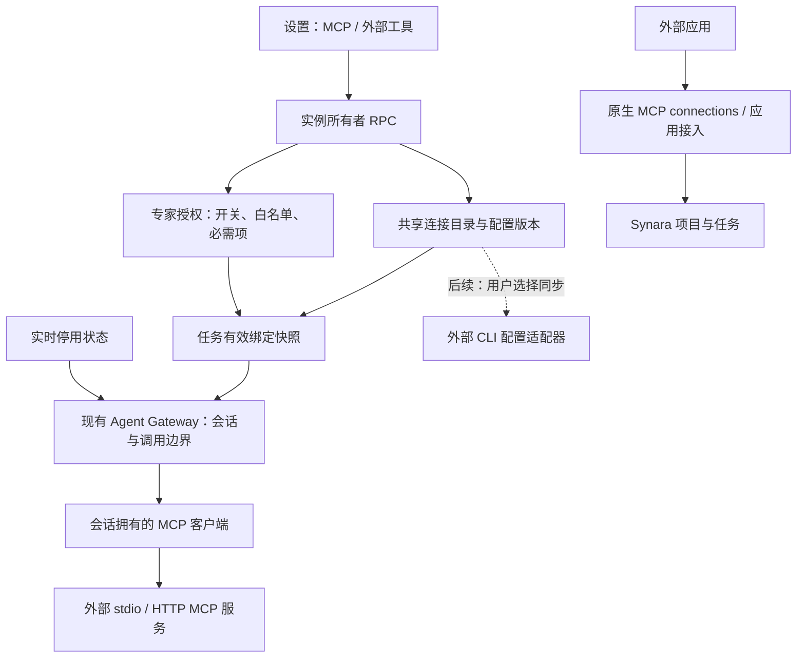

# 全局 MCP 管理技术方案与架构

> 2026-10-05 状态更新：用户已批准精简原型并完成 MCP-0 / MCP-1 候选实施。本地实际应用操作、Global 面板 browser suite 与集中自动化门禁均已记录；未覆盖运行边界见[实施验收记录](./global-mcp-implementation-acceptance.md)。本记录不代表正式安装、发布或真实 Provider 任务验收。

用户已批准首期落地，并于 2026-10-08 确认本机发现、配置去重和独立导入。普通任务独立选择与反向同步外部 CLI 配置仍为后续提案。

> 2026-10-08 导入归属调整：以下 7.1 为当前已确认的实施规则。先前候选使用来源引用读取环境变量和请求头；新导入改为 Synara 私有凭证引用，来源信息仅作追溯。检查结果见实施验收记录，本文不把设计确认视为运行验收。

## 1. 结论与范围

建议把现有“专家外部工具（MCP）”升级为实例级的 MCP 管理中心，复用连接目录、专家授权和 Agent Gateway。设置页提供统一的“MCP”入口，内部区分“外部工具”和“应用接入”。

这里的“全局”是同一个 Synara 服务实例的共享配置，不是跨设备账户同步。远程使用时，命令、环境变量和配置文件都属于服务端主机；浏览器所在电脑的 CLI 配置不能直接当作服务端配置。

首期实施范围为统一入口、连接管理、按专家授权、引用查看与配置版本固定（MCP-0、MCP-1）。普通任务独立选择 MCP、外部 CLI 配置同步仍为后续阶段。

### 1.1 两种 MCP 的边界

| 设置页分区 | 调用方向                    | 管理内容                                 | 授权对象       |
| ---------- | --------------------------- | ---------------------------------------- | -------------- |
| 外部工具   | Synara 任务 → 外部 MCP 服务 | 服务定义、工具发现、专家授权、运行时绑定 | 专家及其任务   |
| 应用接入   | 外部应用 → Synara           | 现有配对、接入凭证、项目/任务范围        | 外部应用客户端 |

两个分区共享导航和 Synara 原生界面组件，保留各自的凭证、协议入口和权限逻辑。原生 MCP connections 页面对应“应用接入”。

### 1.2 当前候选代码事实

截至 2026-10-05，候选工作树基于 `61df29b094d3e5f2877f7787613655220a4f72a2`，包含未提交改动；主检出尚未包含这些改动。MCP-0 / MCP-1 已按验收记录完成本地范围验证；以下能力不代表正式安装、发布、Windows 包或真实 Provider 任务已验证。候选指纹与日志位置见验收记录。

- `ExpertConnectionStore` 保留 `expert-connections/<id>.json` 旧 current 路径，在 `revisions/<id>/<revision>.json` 保存不可变配置归档，并在 `state/<id>.json` 独立保存 `active / disabled / retired` 状态。配置保存使用 expected revision；状态更新使用独立 CAS revision。状态监听覆盖同一进程、同一 stateDir 的 store 实例；不支持多个 server 进程共享 stateDir。
- `ExpertMcpBindingStore` 将旧快照首次补建的绑定保存在 `expert-mcp-bindings/<snapshotId>.json`，提供只读、`createOnce` 与锁内单次捕获。绑定不可覆盖；快照本身保持不变。
- `packages/contracts/src/mcp.ts` 定义连接状态、状态输入、快照绑定及引用结果。`ExpertConnectionConfig` 仍是 strict schema，状态不混入配置；`ExpertSnapshot` 新增可选 `mcpBinding`。
- `ExpertStore.prepareSnapshot` 对启用且白名单非空的连接 pin 当前 revision，并把连接 ID、revision、required 与工具白名单写入新快照。绑定参与快照内容 hash，`createdAt` 不参与；旧快照没有 `mcpBinding` 时仍按旧 hash 验证。旧快照在首次安全运行边界通过 sidecar 一次补建；没有 current 的可选连接保留绑定 ID，但省略 `configRevision`，后续不会自动读取最新配置。
- `ExpertGatewayTools` 按绑定 revision 建连；必需连接缺失/不可用会阻止启动，可选连接跳过并记录问题。调用分派前再读实时状态；停用或退役事件会撤销调用资格、abort 在途 MCP 调用并请求关闭客户端。状态 RPC 的返回只确认状态持久化，不等同于远端副作用撤回或所有客户端已关闭。
- WebSocket RPC 已包含连接列表、保存、删除、显式检查、读取/设置状态与读取引用。引用结果由 RPC 层合并专家、快照、任务和当前会话数；底层扫描会校验快照 schema、资源及 hash，遇损坏或不安全路径时拒绝删除。
- `ExpertMcpClient` 只解析 `envFromHost` / `headersFromHost` 环境变量引用；配置、绑定和结果契约不接收明文凭证。连接检查返回本次工具名与配置 revision；持久化的最近健康历史不由该 RPC 提供，UI 应避免把一次检查显示成持续健康。
- 用户于 2026-10-05 批准精简原型进入正式 UI 实施。原型独立 QA 只覆盖示例数据；正式候选的手工页面/API 操作、测试和未覆盖边界按[实施验收记录](./global-mcp-implementation-acceptance.md)记录。

## 2. CC Switch 的参考边界

参考基线为官方仓库 `farion1231/cc-switch` 的 `v3.20.4` 标签，避免混用持续变化的 main。已核对文档及相关源码，并补充查看了本机 CC Switch 的 MCP 列表、新增面板与配置向导；未验证全部客户端的加载、格式保真或失败恢复。实际界面观察和交互适配见[交互设计方案](./global-mcp-interaction-design.md)。

| 源码确认的能力                                                | 对本方案的启发                                          | 官方证据                                                                                                                                                                                                          |
| ------------------------------------------------------------- | ------------------------------------------------------- | ----------------------------------------------------------------------------------------------------------------------------------------------------------------------------------------------------------------- |
| 统一 `McpServer` 与各应用独立启用标记                         | 一份连接目录，各使用方独立选择                          | [模型](https://github.com/farion1231/cc-switch/blob/v3.20.4/src-tauri/src/app_config.rs#L255-L270) / [应用标记](https://github.com/farion1231/cc-switch/blob/v3.20.4/src-tauri/src/app_config.rs#L5-L53)          |
| Claude/Codex 导入遇已有 ID 时仅启用来源应用，不更新原连接配置 | Synara 应显式比较配置、预览冲突，不能将重复导入当作更新 | [Claude 导入](https://github.com/farion1231/cc-switch/blob/v3.20.4/src-tauri/src/mcp/claude.rs#L45-L107) / [Codex 导入](https://github.com/farion1231/cc-switch/blob/v3.20.4/src-tauri/src/mcp/codex.rs#L41-L260) |
| 各应用分别处理格式，Codex 使用 TOML 编辑                      | 保留通用模型与应用格式适配器两层                        | [Codex 适配](https://github.com/farion1231/cc-switch/blob/v3.20.4/src-tauri/src/mcp/codex.rs#L262-L325)                                                                                                           |
| 写入采用临时文件后替换                                        | Synara 增加文件指纹复核、备份和逐目标结果               | [原子写入](https://github.com/farion1231/cc-switch/blob/v3.20.4/src-tauri/src/config.rs#L323-L355)                                                                                                                |

上述原子写入证据不能证明每次 MCP 客户端配置写入均有单独备份。参考产品的应用支持列表也不能证明 Synara 的 Provider 具备同样能力。

以下是 Synara 的设计取舍：

| 可借鉴的交互     | Synara 的落地方式                        | 范围     |
| ---------------- | ---------------------------------------- | -------- |
| 统一服务目录     | 同一实例维护一份连接定义，专家引用其 ID  | 首期     |
| 按使用方启用     | 专家开关 + 每位专家独立工具白名单        | 首期     |
| 从已有配置导入   | 发现、去重、处理重名及凭证，再存入目录   | 已批准   |
| 写入目标应用配置 | 独立格式适配器、差异预览、备份和冲突检测 | 可选后续 |

## 3. 架构总览



可编辑图：[global-mcp-architecture.drawio](./diagrams/global-mcp-architecture.drawio)；[在浏览器打开架构图](https://viewer.diagrams.net/?tags=%7B%7D&lightbox=1&edit=_blank#R1Zn%2FT9tGFMB%2F5684pdL4YRqxTb4YBVNVaOsmtRIandb9aOJL4tXxIccU2E9pabowSEi3QgsEEFuzMjFCq260kFCk%2FSkbd05%2B4l%2FY%2BZzEgdFvNOkI%2FJDzu2f77uP33r17139xIq6Bm9BIqEiXuvkerhtAPYwUVY9K3V9d%2B%2BwTsfviQFd%2FfCKiahDEUMKUPIohj6vI07jNIwR6uB7OM9AFQL%2BiylFDjgNdjkPJg1Mb%2BGkSXB0cAlZx3crdPSovVX9dIPk1pk314xOXDXk0dhUpUAOjcpTexHtY42tVMWP0ig9wjuBzqEZj9P08J1KJMlHvUyZrMueR9KEGQmb9gr1jEGoaUBXJQ9W9p%2FewtxpQN1%2BnJNBZy9rYaTMDfz0HztTI6g5ZvUPmcmQ97QEJc1Kj%2BgYa0xWoSHxoPKaacHhUDkNpnE49FDPjGhVTwNog0pAhXYj47f9QwjTQDViTBdhfKIJ0c1j9Dkp8IMS%2BgAknjo2d97gjd%2FBCFIemMQnkhOSJ1i48gN7lo%2FOk6AT6M15jzdmyWI2z%2FwQHrwPidDK9DTKV4ktrvwj%2Bvvsjo2P%2F4kcL1akN%2FLyAU88%2FusBzoWoqY%2Bt4weGLn3Bxh2TTZGWKXlr5NVxcJX%2FOVLbnz4ROkaEYCZ9AFxbhSKQd6HjeZSc0oxPfBZ3PNari6uHLGTKdJPnpSjIFvhwaZLjwo4x1fwNn1yil6mKu8nLXmp89z3x6xVYC8jd53dPDvc3KwSrJFqzlIt6fZ3wOX2Tw3Daee%2BjYlTWdJvnfz8bHD0XFd5yPKIz0ttj1gkIr%2BQQafJrdybGcchKnnoGPgbW4j3MZnJmnbXyQquaT1fXdMyGCPIUUPI6oLxDsldsSnXpbQijoEiqV8A%2Fr1L%2FIfNoq3cPFJXywaaUeM1oOOLJSIHs5ysmxM2DAm6q90J1ng6o7XGtwiQ1cVvYJZQUuRemAwGXZhOPypONy5aXK9kplb%2FOwtE8Dd%2BXJFI1Q7xGYIhEYCJ8ITEqwb4Tj2uJ4reHU1xy5yYMdfCtPKZDsY5zecda5hyWy9TPOZa3SloPoPLtcHY4gvAJO4F3g2ITrTseMhcwUqC1ZS3dYXjCoqXR8TpAq7VFXa1gRbeC5BbKTthupZ9UHW%2Bd5qatD8wVbYVE875oUS5oYK5LP0KDFWCVMRUUUzOfXrg2d5%2BSyjiXQEkfj3cS7MWmoROEwayLDjKEo0mXt07os5CJxe68gNEoF30LTnGTzlMdMVEcEdeWSYaBxaURD4RtNLHwhOKGa120V%2BvuNxPX4qTKd53WJcxqOzAPsEZ3gBRJozKAfw86PTdmIQtPO996OogE12VRvOo98e1S9nY7K56LytxeVr9NRBVxUwfai8nc6qqCLSmwvKjcdx8t7NME8dVPyoeExaAwf34BX50jxvQGe%2F%2F3srPkOeg8dqeyojyJVNxMn%2BtlTh%2BweeyERG2WK4wvGfzX93Ks1%2B73spceG7nXH%2FtbfNvj%2Fu8H7fcm%2BD%2BYGYqejEl1UPNdeVn2dzsrO8hqw%2BLbCErgTKTLeu3%2FWjdWHrbQGxVbkwgL%2F2lIrg0GyBZwqOJur7Jp1f431h5Guw7CpIj3RCcXDFuFytw7Dk7psyKC6vmsts%2BIzqwU55YyDFWt%2B0WFVmZ3Cy38cvsg65aBO2Hy2CFXHbx2EpjAktDkMdfzmwQ4kDVhCe2H5m0rUj6zHGafSQxZ2ce5erajPYhmNWnjul6PyLE7fxenNmlt%2Bv1XZvmU7JDv%2B%2BCd524lsrKyG57aryemj8hJZLFaTS45PUwmZ%2Bc0Oekfl5cErXwAnB8fbZfoCL87Nkq1CNXmbSvHiBn1eBywefa88p3uDj%2Fd73eNQlvM2zlvZga23dmI70GV32se8A13%2FAg%3D%3D)。本机 draw.io 启动器所指向的桌面应用缺失，未导出 PNG；已检查图 XML，文档另提供 Mermaid 示意。

### 3.1 模块职责

| 模块             | 候选中的实际职责                                                                         | 实施边界                                             |
| ---------------- | ---------------------------------------------------------------------------------------- | ---------------------------------------------------- |
| 全局管理界面     | 外部工具连接、引用、按专家授权；应用接入继续使用原生 connections                         | 候选 UI 已完成本地验收；具体覆盖与限制见实施验收记录 |
| Registry         | `ExpertConnectionStore` 兼容旧 current 路径，管理不可变版本、状态 CAS、引用删除保护      | 进程内串行；同 stateDir 多 server 进程不受支持       |
| Grant service    | 继续复用专家定义中的连接开关、必需项与白名单                                             | 不复制授权数据；新快照绑定固定授权与连接版本         |
| Binding resolver | `ExpertStore` 为新快照生成绑定；`ExpertGatewayTools` 为旧快照补建 sidecar 并解析会话目录 | 同一 snapshotId 的 legacy binding 只捕获一次         |
| Agent Gateway    | 校验绑定版本与实时状态、暴露允许工具、处理停用调用                                       | 遵守既有任务身份、批准、取消和会话所有权边界         |
| MCP Client       | 建连、发现、调用、超时、取消和关闭                                                       | 解析主机、旧来源或Synara凭证引用；复用共享进程边界   |
| 本机配置导入     | 只读解析、实际配置去重、冲突处理及独立保存                                               | 来源只作追溯；反向同步仍为后续能力                   |

### 3.2 代码落点

以下是候选工作树中的实际代码落点；正式 UI 与运行时验收结果另记。

| 位置                                                                                                               | 候选职责                                                                    |
| ------------------------------------------------------------------------------------------------------------------ | --------------------------------------------------------------------------- |
| `packages/contracts/src/mcp.ts`、`expert.ts`、`index.ts`                                                           | MCP 状态、输入、引用与绑定契约；`ExpertSnapshot.mcpBinding` 为可选字段      |
| `apps/server/src/experts/ExpertConnectionStore.ts`                                                                 | 旧 current 兼容、配置 revision 归档、状态 CAS、事件订阅与删除引用扫描       |
| `apps/server/src/experts/ExpertMcpBindingStore.ts`、`ExpertMcpStorage.ts`                                          | 旧快照 sidecar 的一次性补建及 MCP 私有文件读写                              |
| `apps/server/src/experts/ExpertStore.ts`                                                                           | 快照固定连接 revision，并在读快照时统一做 schema、资源和内容 hash 校验      |
| `apps/server/src/experts/ExpertGatewayTools.ts`、`ExpertMcpClient.ts`                                              | legacy binding 解析、绑定版本预检、会话 MCP 目录及实时停用处理              |
| `apps/server/src/workbench/runtimeLayer.ts`、`wsRpc.ts`                                                            | 所有者 RPC：列表、保存、删除、检查、状态读取/设置和引用读取                 |
| `apps/server/src/agentGateway/Layers/AgentGateway.ts`                                                              | 将 MCP 调用接入既有 Gateway 身份、权限、取消与会话生命周期                  |
| `apps/web/src/components/settings/GlobalMcpSettingsPanel.tsx`、`ExpertConnectionsSettingsPanel.tsx` 及专家设置组件 | 全局 MCP 正式设置页、旧连接设置兼容出口与专家授权；浏览器证据见实施验收记录 |
| 工作台注册表与 settings 路由                                                                                       | 统一入口及原连接设置兼容跳转；应用接入沿用既有原生 MCP 页面                 |

避免一次重命名全部 Expert 符号；首期保留兼容 façade，不做无收益的文件路径迁移。

## 4. 数据与权限模型

### 4.1 四种对象

以下为概念映射；实际连接状态与绑定 schema 位于 `packages/contracts/src/mcp.ts`，连接状态不进入 strict `ExpertConnectionConfig`。连接配置继续沿用现有契约。

```ts
// 首期契约概要；连接配置继续沿用现有 ExpertConnectionConfig。
type McpServerRevision = {
  id: string;
  revision: number;
  name: string;
  transport: StdioConfig | HttpConfig; // 沿用现有契约
  updatedAt: string;
};

type McpServerControl = {
  id: string;
  status: "active" | "disabled" | "retired";
  revision: number; // 独立于配置 revision
  updatedAt: string;
};

// 首期直接复用 ExpertConnection；缺失 enabled 按现有兼容语义处理。
type ExpertMcpGrant = {
  id: string;
  enabled?: boolean;
  required: boolean;
  tools: string[];
};

type ExpertMcpBinding = {
  schemaVersion: 1;
  source: "snapshot" | "legacy-current";
  createdAt: string;
  servers: Array<{
    id: string;
    configRevision?: number; // 可选连接缺失时不绑定版本；以后也不回退到最新配置
    required: boolean;
    tools: string[];
  }>;
};
```

配置版本描述“连哪里”，授权描述“谁能用哪些工具”，任务绑定描述“这次任务用了哪个版本”，实时控制描述“现在是否允许调用”。四者不可混为一个 `enabled`。

### 4.2 授权规则

- 目录中存在服务，不代表所有专家可以使用；新增连接默认不授予任何专家。
- 专家详情页保留“允许使用”开关。管理中心按专家维护白名单与 `required`，显示授权来源与引用。
- 专家开关关闭后保留原白名单；重新打开不自动勾选服务新出现的工具。
- 白名单为空时不建连、不公开工具。连接测试和发现工具均不自动扩大授权。
- 新任务使用当前专家授权和当前连接版本，生成绑定后再启动 Provider；恢复使用该任务已保存的绑定。
- 工具名称保留现有稳定映射，不能因模块改名破坏已运行任务的工具引用。
- 外部工具声明的只读/破坏性提示仅作展示，不能替代 Synara 既有调用批准、任务范围和取消规则。

这里的白名单约束经过 Synara Gateway 的外部 MCP 工具。Provider 自己加载的本机 MCP、插件或其他原生能力有独立边界；未验证会话配置隔离前，不宣称此白名单限制了 Provider 的全部能力。

### 4.3 凭证

手动配置继续支持 `envFromHost / headersFromHost`。本机导入在写入时解析环境变量和来源值，存入 Synara 私有凭证存储；连接定义只包含 `envFromSecret / headersFromSecret` 的不透明 ID 和变量名称。页面、RPC、任务快照和连接配置归档均不包含明文凭证。来源引用仅保留旧版本读取兼容，新导入不再用它建连。

凭证复用现有 `ServerSecretStore` 的私有目录、原子写入及 0600 文件机制，不宣称已加密。每次导入创建新的凭证记录，成功记录不覆盖或自动删除，保证旧连接修订仍能解析自己的凭证。手动主机引用仍在建连时解析；远端实现与动态工具 schema 也可能变化，因此不能承诺历史调用完全重现。OAuth、系统钥匙串和跨设备密钥同步另行设计。

## 5. 任务生命周期与配置更新

### 5.1 准备和启动

1. 在现有 Expert 应用/任务启动链路读取专家快照和连接配置。
2. 将选中连接的不可变配置版本与授权写入任务有效绑定，使用现有编排持久化边界关联到任务/运行记录。不要直接修改任务表。
3. 按这些版本预检并创建会话客户端；必需连接失败则给出明确错误，可选连接失败则继续并记录缺失项。
4. Gateway 仅发布绑定内实际存在的工具；每次调用检查当前连接停用状态和既有任务/会话约束。
5. 取消、会话替换、任务删除及服务关闭时释放会话资源。不要将一次任务的取消传播给另一个任务。

服务目录读取与绑定保存需定义同一个一致性边界：禁止先预检最新版本、后保存另一个版本。所有副作用建连必须读取已选定版本；启动失败的残留客户端必须释放。

首期直接在新建的 `ExpertSnapshot` 内保存可选 `mcpBinding` 字段，通过已有 `ExpertBinding.snapshotId` 关联任务，不新增任务表字段或 SQL 迁移。连接版本、白名单与绑定来源纳入快照内容哈希，`createdAt` 不纳入；旧快照没有该字段时保持原来的哈希算法。配置归档先完成，再写快照与任务引用；失败残留暂不自动删除。运行记录仍以实际成功的 Provider 启动为准，绑定文件本身不证明运行成功。

会话目录以每次凭证签发产生的独立 `sessionKey` 标识 Provider 生命周期，并校验 `snapshotId`；同一 key 更换快照时关闭旧目录。会话替换时撤销旧代调用资格并释放客户端，未完成初始化的客户端也必须在关闭后释放，不能重新进入缓存。关闭工作台功能或缺失绑定时，已绑定专家的任务明确报不可用，不能静默回退成普通任务。

### 5.2 更新影响

| 操作                     | 运行中的任务                                     | 后续新任务 / 恢复                      |
| ------------------------ | ------------------------------------------------ | -------------------------------------- |
| 编辑连接地址、命令或参数 | 保留原绑定与客户端                               | 新任务用新版本；恢复读取原绑定版本     |
| 编辑专家白名单或开关     | 当前绑定保持不变                                 | 新任务使用新授权；恢复保留旧授权       |
| 全局停用连接             | 后续调用立即被拒绝，尝试取消在途调用并关闭客户端 | 新任务与恢复不能使用；必需项明确失败   |
| 重新启用连接             | 不自动重试已失败调用；在安全会话边界重建目录     | 保留任务原绑定与白名单，不自动升级版本 |
| 退役连接                 | 等同停用，目录隐藏常规选择                       | 有引用的历史配置仍可读取，但不能调用   |

停用需持久化、串行化，并在调用派发前检查。候选状态更新后会通知同进程 session catalog，撤销调用资格、abort 在途 MCP 调用并请求关闭客户端；RPC 只返回已持久化状态，不提供每个远端动作是否撤销或客户端是否全部关闭的确认。停用确认前已发出的远端动作无法承诺撤销；取消或关闭失败应记入运行时诊断，不作为状态 RPC/UI 的逐 session 回执。必需连接被停用后不得静默移除工具继续运行：阻止依赖该绑定的下一次启动/恢复并显示原因。运行中返回明确失败与任务提示，接入现有取消/失败边界，不另造任务状态机。逐 session 的取消/关闭结果用于运行时测试或诊断记录；状态更新 RPC 与管理 UI 不提供每个客户端的完成回执。

### 5.3 旧数据与删除

- 保留 `expert-connections/<id>.json` 的旧 ID 和 current 路径；连接管理不搬迁用户配置。
- 候选归档位于 `expert-connections/revisions/<id>/<revision>.json`，实时状态位于独立的 `expert-connections/state/<id>.json`。保存先保证 current 与新 revision 均有不可变归档，再原子更新 current；失败可能留下孤立归档，但不替换旧 current；不同内容不得覆盖同 revision。
- 写队列与状态订阅覆盖进程内、同 stateDir 的 store 实例；多个 server 进程共用一个 stateDir 明确不支持。
- `ExpertSnapshot.mcpBinding` 为可选；新快照把 binding 纳入 hash（排除 `createdAt`），无该字段的旧快照沿用旧 hash。旧任务的首次安全运行边界在 `expert-mcp-bindings/<snapshotId>.json` 生成 immutable `legacy-current` sidecar，不修改快照；多个任务复用该 snapshotId 时共享首次捕获。缺失的可选服务不会在日后回退读取最新版本。
- 删除会扫描专家定义、所有已验证历史快照以及 legacy binding sidecar；扫描数据损坏或路径不安全时 fail closed。有任何引用即返回 `in_use`。无引用删除时先写 `retired` tombstone、保留所有 revision，再删除 current；普通 save 与 active 状态更新不能复活该 ID。不会自动清理历史版本。
- schema 兼容与持久化状态恢复需在交付前记录；回退应用代码不等于回退状态数据。

## 6. 接口、状态与界面

### 6.1 接口划分

候选 RPC 已有以下 schema 与 handler；通过情况以最终验收记录为准：

| 能力          | 当前接口/语义                                                                               | 边界                                                                  |
| ------------- | ------------------------------------------------------------------------------------------- | --------------------------------------------------------------------- |
| 配置目录      | `serverListExpertConnections`、`serverSaveExpertConnection`、`serverRemoveExpertConnection` | 保存采用配置 expected revision；删除受引用扫描保护                    |
| 真实检查/发现 | `serverTestExpertConnection`                                                                | 本次返回工具名称和配置 revision；不等于持久化健康历史                 |
| 全局状态      | `getExpertConnectionState({ id })`、`setExpertConnectionState(input)`                       | 独立状态 revision CAS；`active / disabled / retired`                  |
| 引用与影响    | `readExpertConnectionReferences({ id })`                                                    | 返回专家、快照、任务及 active session count；底层文件扫描 fail closed |
| 任务绑定      | `ExpertSnapshot.mcpBinding` 与旧快照 sidecar                                                | 内部运行数据，无独立 UI 可写 binding 的 RPC                           |
| 本机发现/导入 | `discoverMcpConnections`、`importMcpConnections`                                            | 只读发现；导入后独立保存，不启动服务、不授权专家、不回写来源          |
| CLI 反向同步  | 暂无                                                                                        | 后续能力，不显示为当前可用操作                                        |

状态写入响应只确认状态文件提交。管理 UI 可确认状态已保存、后续调用将被拒绝，并说明服务端尝试取消在途调用与关闭客户端；不得声称这些操作已逐一成功。取消/关闭的实际结果由运行时测试或诊断分别记录。

### 6.2 界面建议

具体列表、编辑与授权操作以[已获批准的交互基线](./global-mcp-interaction-design.md)为准；原型独立 QA 不作为正式 UI 通过证据。

- 设置 → MCP → **外部工具 / 应用接入**；外部工具列表使用连接、全局状态、授权专家、最近检查四列，只显示搜索结果数量，不重复累计统计。
- “已授权 N 位专家”统计启用且白名单非空的专家配置；连接全局停用后仍保留这些授权人数。关闭专家开关的白名单仍构成引用和删除保护，但不计入当前授权人数。
- 连接详情分为连接配置、工具与授权、使用情况；后者按专家引用、任务绑定、活动会话分组。
- 首次授权必须先选至少一个工具才可保存；关闭再启用恢复原白名单，不自动授权新发现工具。
- 真实检查只在用户触发时连接；一次结果须关联配置 revision，不能把“连接已停用”、专家授权和检查结果合并成同一状态。
- 停用、退役和删除在详情操作。存在任何专家、历史快照或 sidecar 引用时禁用硬删除并说明来源；无引用时仍需确认。
- 应用接入复用现有原生 MCP connections 面板；本次确认其页面可访问，未创建配对或变更访问范围，因此不宣称已完成配对验收。
- 保持 Synara 的主题、用户字号、键盘可达性、未保存保护及原生 disclosure 动效；不得把精简原型的像素布局当作正式 UI 实现规格。

## 7. 本机配置导入与后续同步

借鉴 CC Switch 的多应用管理，但作为配置互操作模块单独实施。

### 7.1 导入

只读本实例服务端主机上的 Codex、CC Switch 或指定 JSON → 解析实际配置并去重 → 用户选择、处理冲突 → 独立保存 → 展示逐条结果。解析和导入均不执行命令、不连接服务器、不扩大专家授权、不回写来源。

已确认的归属和去重规则：

- 按实际运行参数及已解析的环境变量、请求头值比较；忽略名称、来源路径和来源客户端的启用标记。HTTP 请求头名称不区分大小写，映射字段顺序不影响等价判断。指纹和值只在服务端使用。
- 等价条目合为一行并记录全部来源；同名而参数、凭证或访问范围不同的条目保留。已有独立连接等价时标为已存在；旧来源/主机引用连接等价时允许显式更新，使其转为独立配置。
- 导入前重新读取每个合并来源，校验原条目指纹和实际值均未变化；来源或主机环境变化时失败并要求重扫。缺失变量、不可转换字段明确标记，禁止静默省略。
- 导入把当前环境变量和请求头值复制到 `stateDir/secrets`，把连接参数写入共享目录；`importedFrom` 保存来源元数据，仅用于追溯。之后修改或移除来源文件不会改变新导入连接。
- 更新采用配置 revision CAS，退役 ID 不复用。新凭证先持久化，再保存引用；失败清理只在证明没有持久化引用时执行，不能损坏可能已写入的修订。旧修订、旧任务及旧来源引用兼容保留，不静默迁移历史配置。
- 操作在发现列表直接完成，无来源筛选、说明段落或独立确认摘要页。结果按连接逐项报告，成功导入仍需用户单独执行真实连接检查和专家授权。

### 7.2 同步到外部应用

每个应用独立实现 JSON/TOML 等格式适配器，并验证实际版本。流程为读取文件及指纹 → 生成局部修改和差异预览 → 确认目标 → 写前复核指纹 → 备份 → 原子写入 → 重读确认。

- 只修改明确受管理的条目，保留用户其他配置与格式语义；并发变化返回冲突。
- 单文件原子写入不等于跨应用事务；批量同步逐目标报告成功/失败，不假称全部同步。
- 配置变化不等于运行中 CLI 已加载，按目标应用说明重启/重载要求。
- 外部 CLI 直接连接服务时不经过 Synara Gateway，因此不能继承专家的工具白名单。界面区分“Synara 内授权”和“同步到独立应用”。
- 若需要外部应用也遵守 Synara 授权，需另设计经过网关的出站工具代理与凭证，不复用现有面向项目/任务的入站配对令牌。

首期不自动接管 CLI 配置，也不要求用户安装 CC Switch。配置互操作与实时 MCP 调用分开验收。

## 8. 实施阶段与最小验收

| 阶段                    | 范围                                                 | 当前状态 / 主要检查                                                                   |
| ----------------------- | ---------------------------------------------------- | ------------------------------------------------------------------------------------- |
| MCP-0：统一管理         | 连接目录、设置入口、专家白名单、引用查看与真实检查   | 候选页面与 RPC 已实现；浏览器、格式、lint、类型及包测试按验收记录分项通过             |
| MCP-1：运行绑定         | 不可变连接版本、快照绑定、实时状态与旧快照兼容       | 存储/runtime 自动化通过；本地检查使用 HTTP fixture，未创建真实任务快照或启动 Provider |
| MCP-2：普通任务（待定） | 普通任务独立选择连接与白名单                         | 当前不实现、不默认开放                                                                |
| MCP-3：CLI 互操作       | 本机发现、独立导入、配置去重与冲突处理；后续反向同步 | 本机导入已获批准；反向同步当前不实现                                                  |

用户于 2026-10-05 已批准精简原型作为正式 UI 实施基线。原型独立验收只证明示例数据原型的视觉和交互；正式候选的实测范围及未覆盖项见[实施验收记录](./global-mcp-implementation-acceptance.md)。

最终验收按[开发流程](./workbench-development-workflow.md)运行受影响测试及集中格式、lint、类型和测试门禁。需要时降低 workspace/package 并发以减少计时敏感测试的资源竞争，不修改测试 timeout 来掩盖问题。迁移/平台进程边界只在本次变更实际触及时运行对应门禁。真实 MCP 接入使用可控本地 fixture，不使用用户服务或凭证；不将 mock、单测或模型回答成功视为 Provider 全面验证。

Provider 接入沿用现有适配器。当前通用 capability 接口不能直接证明每种 Provider 支持此网关，应补齐可查询的 MCP 接入能力或现有等价判断，界面仅开放已经验证的组合。

## 9. 待决定事项

1. **普通任务是否可独立选择 MCP？** 建议预留消费者模型，但首期只覆盖专家任务，不默认把全部连接开放给普通任务。
2. **是否需要管理 Synara 之外的 CLI？** 建议先做好实例内管理，再按实际使用目标选择一至两个配置适配器。

这两项不影响先讨论和评审 MCP-0/1 的技术设计；实施阶段以用户确定的范围为准。

## 10. 关联资料

- [全局 MCP 交互设计方案](./global-mcp-interaction-design.md)
- [专家前端修改方案](./expert-frontend-redesign-plan.md)
- [工作台架构](./workbench-architecture.md)
- [工作台开发流程](./workbench-development-workflow.md)
- [原生外部 MCP 接入](./external-mcp.md)
- [Provider 边界](./providers.md)
