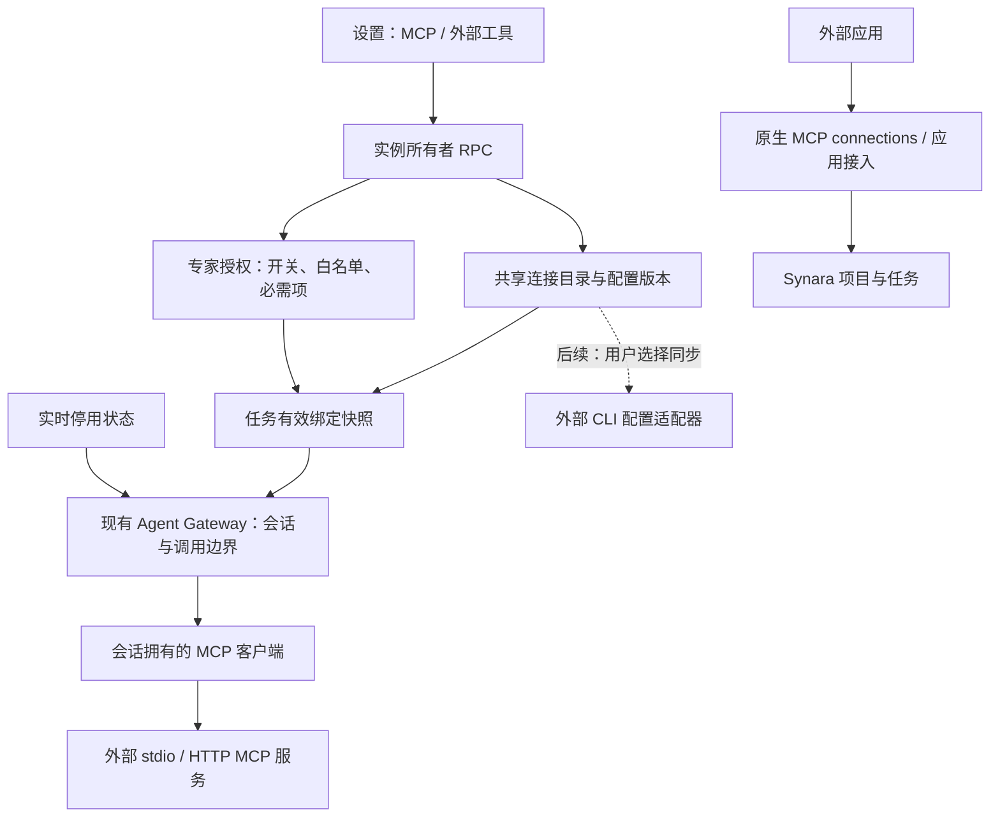

# 全局 MCP 管理技术方案与架构


> 2026-10-04 实施安排更新：用户要求先查看前端交互原型，确认后再落地正式界面。后台存储、契约和运行时继续推进；原型使用示例数据，不接真实 API。
状态：设计提案，待确定实施范围。日期：2026-10-04。

本轮产出技术设计，不修改应用行为。本文的“建议”“拟新增”均为提案，不代表已实现或已获实施授权。

## 1. 结论与范围

建议把现有“专家外部工具（MCP）”升级为实例级的 MCP 管理中心，复用连接目录、专家授权和 Agent Gateway。设置页提供统一的“MCP”入口，内部区分“外部工具”和“应用接入”。

这里的“全局”是同一个 Synara 服务实例的共享配置，不是跨设备账户同步。远程使用时，命令、环境变量和配置文件都属于服务端主机；浏览器所在电脑的 CLI 配置不能直接当作服务端配置。

首期建议完成统一入口、连接管理、按专家授权、引用查看与配置版本固定。普通任务独立选择 MCP、外部 CLI 配置同步可作为后续阶段。它们需要独立决定范围。

### 1.1 两种 MCP 的边界

| 设置页分区 | 调用方向 | 管理内容 | 授权对象 |
| --- | --- | --- | --- |
| 外部工具 | Synara 任务 → 外部 MCP 服务 | 服务定义、工具发现、专家授权、运行时绑定 | 专家及其任务 |
| 应用接入 | 外部应用 → Synara | 现有配对、接入凭证、项目/任务范围 | 外部应用客户端 |

两个分区共享导航和 Synara 原生界面组件，保留各自的凭证、协议入口和权限逻辑。原生 MCP connections 页面对应“应用接入”。

### 1.2 当前代码事实

设计核对对象包括主检出及尚未合并的专家前端候选工作树。主检出 HEAD 为 `8e5c12b963e3dd143837aa751e1749b5b55f5d73`；候选工作树基于 `61df29b094d3e5f2877f7787613655220a4f72a2`，含未提交修改。因此候选行为不能当作主分支已交付功能。

候选代码已提供：

- `ExpertConnectionStore`：按实例 `stateDir` 保存共享连接，具有 revision 检查和原子文件写入。
- `ExpertConnection`：专家保存 `id / enabled / required / tools`，其中 `tools` 是该专家的白名单。
- `ExpertMcpClient`：外部 MCP 连接、工具发现和调用。
- `ExpertGatewayTools`：按任务专家快照筛选工具，每个会话拥有客户端并负责关闭。
- 独立连接管理页与专家页开关；连接测试为显式真实操作。

**当前缺口：专家快照固定授权，但没有固定外部连接配置版本。** Resolver 创建会话目录时仍按连接 ID 读取最新配置。配置改动可能影响后续会话及恢复，不能把“专家快照不可变”等同于“外部连接不可变”。

## 2. CC Switch 的参考边界

参考基线为官方仓库 `farion1231/cc-switch` 的 `v3.20.4` 标签，避免混用持续变化的 main。已核对文档及相关源码，并补充查看了本机 CC Switch 的 MCP 列表、新增面板与配置向导；未验证全部客户端的加载、格式保真或失败恢复。实际界面观察和交互适配见[交互设计方案](./global-mcp-interaction-design.md)。

| 源码确认的能力 | 对本方案的启发 | 官方证据 |
| --- | --- | --- |
| 统一 `McpServer` 与各应用独立启用标记 | 一份连接目录，各使用方独立选择 | [模型](https://github.com/farion1231/cc-switch/blob/v3.20.4/src-tauri/src/app_config.rs#L255-L270) / [应用标记](https://github.com/farion1231/cc-switch/blob/v3.20.4/src-tauri/src/app_config.rs#L5-L53) |
| Claude/Codex 导入遇已有 ID 时仅启用来源应用，不更新原连接配置 | Synara 应显式比较配置、预览冲突，不能将重复导入当作更新 | [Claude 导入](https://github.com/farion1231/cc-switch/blob/v3.20.4/src-tauri/src/mcp/claude.rs#L45-L107) / [Codex 导入](https://github.com/farion1231/cc-switch/blob/v3.20.4/src-tauri/src/mcp/codex.rs#L41-L260) |
| 各应用分别处理格式，Codex 使用 TOML 编辑 | 保留通用模型与应用格式适配器两层 | [Codex 适配](https://github.com/farion1231/cc-switch/blob/v3.20.4/src-tauri/src/mcp/codex.rs#L262-L325) |
| 写入采用临时文件后替换 | Synara 增加文件指纹复核、备份和逐目标结果 | [原子写入](https://github.com/farion1231/cc-switch/blob/v3.20.4/src-tauri/src/config.rs#L323-L355) |

上述原子写入证据不能证明每次 MCP 客户端配置写入均有单独备份。参考产品的应用支持列表也不能证明 Synara 的 Provider 具备同样能力。

以下是 Synara 的设计取舍：

| 可借鉴的交互 | Synara 的落地方式 | 范围 |
| --- | --- | --- |
| 统一服务目录 | 同一实例维护一份连接定义，专家引用其 ID | 首期 |
| 按使用方启用 | 专家开关 + 每位专家独立工具白名单 | 首期 |
| 从已有配置导入 | 解析、预览、处理重名及凭证，再存入目录 | 后续 |
| 写入目标应用配置 | 独立格式适配器、差异预览、备份和冲突检测 | 可选后续 |

## 3. 架构总览



可编辑图：[global-mcp-architecture.drawio](./diagrams/global-mcp-architecture.drawio)；[在浏览器打开架构图](https://viewer.diagrams.net/?tags=%7B%7D&lightbox=1&edit=_blank#R1Zn%2FT9tGFMB%2F5684pdL4YRqxTb4YBVNVaOsmtRIandb9aOJL4tXxIccU2E9pabowSEi3QgsEEFuzMjFCq260kFCk%2FSkbd05%2B4l%2FY%2BZzEgdFvNOkI%2FJDzu2f77uP33r17139xIq6Bm9BIqEiXuvkerhtAPYwUVY9K3V9d%2B%2BwTsfviQFd%2FfCKiahDEUMKUPIohj6vI07jNIwR6uB7OM9AFQL%2BiylFDjgNdjkPJg1Mb%2BGkSXB0cAlZx3crdPSovVX9dIPk1pk314xOXDXk0dhUpUAOjcpTexHtY42tVMWP0ig9wjuBzqEZj9P08J1KJMlHvUyZrMueR9KEGQmb9gr1jEGoaUBXJQ9W9p%2FewtxpQN1%2BnJNBZy9rYaTMDfz0HztTI6g5ZvUPmcmQ97QEJc1Kj%2BgYa0xWoSHxoPKaacHhUDkNpnE49FDPjGhVTwNog0pAhXYj47f9QwjTQDViTBdhfKIJ0c1j9Dkp8IMS%2BgAknjo2d97gjd%2FBCFIemMQnkhOSJ1i48gN7lo%2FOk6AT6M15jzdmyWI2z%2FwQHrwPidDK9DTKV4ktrvwj%2Bvvsjo2P%2F4kcL1akN%2FLyAU88%2FusBzoWoqY%2Bt4weGLn3Bxh2TTZGWKXlr5NVxcJX%2FOVLbnz4ROkaEYCZ9AFxbhSKQd6HjeZSc0oxPfBZ3PNari6uHLGTKdJPnpSjIFvhwaZLjwo4x1fwNn1yil6mKu8nLXmp89z3x6xVYC8jd53dPDvc3KwSrJFqzlIt6fZ3wOX2Tw3Daee%2BjYlTWdJvnfz8bHD0XFd5yPKIz0ttj1gkIr%2BQQafJrdybGcchKnnoGPgbW4j3MZnJmnbXyQquaT1fXdMyGCPIUUPI6oLxDsldsSnXpbQijoEiqV8A%2Fr1L%2FIfNoq3cPFJXywaaUeM1oOOLJSIHs5ysmxM2DAm6q90J1ng6o7XGtwiQ1cVvYJZQUuRemAwGXZhOPypONy5aXK9kplb%2FOwtE8Dd%2BXJFI1Q7xGYIhEYCJ8ITEqwb4Tj2uJ4reHU1xy5yYMdfCtPKZDsY5zecda5hyWy9TPOZa3SloPoPLtcHY4gvAJO4F3g2ITrTseMhcwUqC1ZS3dYXjCoqXR8TpAq7VFXa1gRbeC5BbKTthupZ9UHW%2Bd5qatD8wVbYVE875oUS5oYK5LP0KDFWCVMRUUUzOfXrg2d5%2BSyjiXQEkfj3cS7MWmoROEwayLDjKEo0mXt07os5CJxe68gNEoF30LTnGTzlMdMVEcEdeWSYaBxaURD4RtNLHwhOKGa120V%2BvuNxPX4qTKd53WJcxqOzAPsEZ3gBRJozKAfw86PTdmIQtPO996OogE12VRvOo98e1S9nY7K56LytxeVr9NRBVxUwfai8nc6qqCLSmwvKjcdx8t7NME8dVPyoeExaAwf34BX50jxvQGe%2F%2F3srPkOeg8dqeyojyJVNxMn%2BtlTh%2BweeyERG2WK4wvGfzX93Ks1%2B73spceG7nXH%2FtbfNvj%2Fu8H7fcm%2BD%2BYGYqejEl1UPNdeVn2dzsrO8hqw%2BLbCErgTKTLeu3%2FWjdWHrbQGxVbkwgL%2F2lIrg0GyBZwqOJur7Jp1f431h5Guw7CpIj3RCcXDFuFytw7Dk7psyKC6vmsts%2BIzqwU55YyDFWt%2B0WFVmZ3Cy38cvsg65aBO2Hy2CFXHbx2EpjAktDkMdfzmwQ4kDVhCe2H5m0rUj6zHGafSQxZ2ce5erajPYhmNWnjul6PyLE7fxenNmlt%2Bv1XZvmU7JDv%2B%2BCd524lsrKyG57aryemj8hJZLFaTS45PUwmZ%2Bc0Oekfl5cErXwAnB8fbZfoCL87Nkq1CNXmbSvHiBn1eBywefa88p3uDj%2Fd73eNQlvM2zlvZga23dmI70GV32se8A13%2FAg%3D%3D)。本机 draw.io 启动器所指向的桌面应用缺失，未导出 PNG；已检查图 XML，文档另提供 Mermaid 示意。

### 3.1 模块职责

| 模块 | 职责 | 实施方式 |
| --- | --- | --- |
| 全局管理界面 | 服务配置、引用、授权、真实测试状态 | 扩展现有管理页，复用表单、行、对话框和未保存提示 |
| Registry | 配置读取、revision CAS、不可变版本、停用状态 | 从 `ExpertConnectionStore` 提取通用接口，兼容旧名称与路径 |
| Grant service | 读写专家引用和白名单 | 首期仍通过现有 Expert 保存接口修改，不复制一套授权数据 |
| Binding resolver | 将专家授权与具体连接版本组合为任务有效绑定 | 从现有 resolver 分离“准备绑定”和“建立会话目录” |
| Agent Gateway | 验证任务/会话身份，公开允许的工具，检查停用并调用 | 扩展原有 Gateway，保留原生工具与其他会话消费者 |
| MCP Client | 建连、发现、调用、超时、取消、关闭 | 复用 `ExpertMcpClient`；进程操作继续走共享平台边界 |
| CLI adapters | 导入/导出格式转换、文件差异和冲突处理 | 独立可选模块，不混入任务运行时 |

`packages/contracts` 只放 schema；运行编排留在 server；共享工具只通过明确 subpath 导出。工作台沿用编译期注册机制。无需新建后端服务、数据库或全局 MCP 常驻进程池。

### 3.2 代码落点

路径以下述候选工作树为参照，新增名称为建议：

| 位置 | 变化 |
| --- | --- |
| `packages/contracts/src/expert.ts` | 保留专家引用兼容；新增通用 MCP 契约使用独立 `mcp.ts` 与明确导出 |
| `apps/server/src/experts/ExpertConnectionStore.ts` | 通过通用 store 接口复用已有实现，逐步提取版本与控制状态，不复制存储 |
| `apps/server/src/experts/ExpertGatewayTools.ts` | 保留 Expert 入口；提取可复用的 binding resolver 与会话目录构建 |
| `apps/server/src/experts/ExpertMcpClient.ts` | 复用传输实现；只在新增消费者确有需要时迁入通用 MCP 目录 |
| `apps/server/src/workbench/runtimeLayer.ts`、`wsRpc.ts` | 接线、所有者鉴权、兼容 RPC 与错误传递 |
| `apps/server/src/agentGateway/Layers/AgentGateway.ts` | 接入有效绑定、实时停用检查及会话清理 |
| `apps/web/src/components/settings/ExpertConnectionsSettingsPanel.tsx` | 复用候选管理页；具体移动路径与公共组件提取在实施时核对 |
| 工作台注册表与 settings 路由 | 注册统一 MCP 页，保留原入口跳转；复用原生应用接入组件 |

避免一次重命名全部 Expert 符号；首期用 façade 明确通用职责，后续随消费者增加再调整归属。

## 4. 数据与权限模型

### 4.1 四种对象

```ts
// 提案示意，字段命名在实施时与已有契约对齐。
type McpServerRevision = {
  id: string;
  revision: number;
  name: string;
  transport: StdioConfig | HttpConfig; // 沿用现有契约
  updatedAt: string;
};

type McpServerControl = {
  id: string;
  status: "active" | "disabled" | "retired";
  controlRevision: number;
};

// 首期直接复用 ExpertConnection；缺失 enabled 按现有兼容语义处理。
type ExpertMcpGrant = {
  id: string;
  enabled?: boolean;
  required: boolean;
  tools: string[];
};

type TaskMcpBinding = {
  schemaVersion: 1;
  source: { expertSnapshotId: string };
  servers: Array<{
    id: string;
    configRevision: number;
    required: boolean;
    tools: string[];
  }>;
};
```

配置版本描述“连哪里”，授权描述“谁能用哪些工具”，任务绑定描述“这次任务用了哪个版本”，实时控制描述“现在是否允许调用”。四者不可混为一个 `enabled`。

### 4.2 授权规则

- 目录中存在服务，不代表所有专家可以使用；新增连接默认不授予任何专家。
- 专家详情页保留“允许使用”开关。管理中心按专家维护白名单与 `required`，显示授权来源与引用。
- 专家开关关闭后保留原白名单；重新打开不自动勾选服务新出现的工具。
- 白名单为空时不建连、不公开工具。连接测试和发现工具均不自动扩大授权。
- 新任务使用当前专家授权和当前连接版本，生成绑定后再启动 Provider；恢复使用该任务已保存的绑定。
- 工具名称保留现有稳定映射，不能因模块改名破坏已运行任务的工具引用。
- 外部工具声明的只读/破坏性提示仅作展示，不能替代 Synara 既有调用批准、任务范围和取消规则。

这里的白名单约束经过 Synara Gateway 的外部 MCP 工具。Provider 自己加载的本机 MCP、插件或其他原生能力有独立边界；未验证会话配置隔离前，不宣称此白名单限制了 Provider 的全部能力。

### 4.3 凭证

沿用 `envFromHost / headersFromHost` 的环境变量引用，不在连接定义、任务快照、预览和日志里保存明文密钥。环境变量在服务端建连时解析；缺失时给出可处理错误。

固定配置版本不代表固定环境变量实际值、远端服务实现或动态工具 schema。密钥轮换可以影响恢复后的建连。界面需要明确显示配置版本与最近发现结果，不能承诺历史调用可完全重现。安全存储、OAuth 与跨设备密钥同步另行设计。

## 5. 任务生命周期与配置更新

### 5.1 准备和启动

1. 在现有 Expert 应用/任务启动链路读取专家快照和连接配置。
2. 将选中连接的不可变配置版本与授权写入任务有效绑定，使用现有编排持久化边界关联到任务/运行记录。不要直接修改任务表。
3. 按这些版本预检并创建会话客户端；必需连接失败则给出明确错误，可选连接失败则继续并记录缺失项。
4. Gateway 仅发布绑定内实际存在的工具；每次调用检查当前连接停用状态和既有任务/会话约束。
5. 取消、会话替换、任务删除及服务关闭时释放会话资源。不要将一次任务的取消传播给另一个任务。

服务目录读取与绑定保存需定义同一个一致性边界：禁止先预检最新版本、后保存另一个版本。所有副作用建连必须读取已选定版本；启动失败的残留客户端必须释放。

建议有效绑定保存为实例内不可变文件，通过既有编排事件/投影保存 binding ID；文件先完整落盘，再提交任务引用，失败残留暂不自动删除。若需要新增投影字段，使用工作台迁移通道并检查真实旧 schema。运行记录只记录实际成功加载的版本与工具，不能把启动意图记录成成功。

会话目录缓存应包含 binding ID 与 Provider lifecycle generation；会话替换时撤销旧代调用资格并释放客户端。关闭工作台功能或缺失绑定时，已绑定专家的任务明确报不可用，不能静默回退成普通任务。

### 5.2 更新影响

| 操作 | 运行中的任务 | 后续新任务 / 恢复 |
| --- | --- | --- |
| 编辑连接地址、命令或参数 | 保留原绑定与客户端 | 新任务用新版本；恢复读取原绑定版本 |
| 编辑专家白名单或开关 | 当前绑定保持不变 | 新任务使用新授权；恢复保留旧授权 |
| 全局停用连接 | 后续调用立即被拒绝，尝试取消在途调用并关闭客户端 | 新任务与恢复不能使用；必需项明确失败 |
| 重新启用连接 | 不自动重试已失败调用；在安全会话边界重建目录 | 保留任务原绑定与白名单，不自动升级版本 |
| 退役连接 | 等同停用，目录隐藏常规选择 | 有引用的历史配置仍可读取，但不能调用 |

停用需持久化、串行化，并在调用派发前检查。停用确认前已发出的远端动作无法承诺撤销；取消失败要如实记录。必需连接被停用后不得静默移除工具继续运行：阻止依赖该绑定的下一次启动/恢复并显示原因。运行中返回明确失败与任务提示，接入现有取消/失败边界，不另造任务状态机。

### 5.3 旧数据与删除

- 保留 `expert-connections/<id>.json` 的旧 ID 和目录兼容读取。更名主要发生在界面和服务接口，不做无收益的文件搬迁。
- 增加不可变版本归档：写新版本成功后才能更新 current 指针；读者遇到半写、非法版本或缺失配置须报错。
- 建议归档位于 `expert-connections/revisions/<id>/<revision>.json`，控制状态使用独立版本化记录。单连接保存沿用串行锁与 expectedRevision：先写不可变归档，再原子更新当前配置；提交前中断留下孤立归档不影响旧 current，重复版本内容不一致必须拒绝。对跨进程并发的支持边界在实施时明确，不能把进程内锁当作文件级互斥。
- 旧专家引用无需重写；`enabled` 缺失沿用既有行为。
- 旧任务没有连接版本时，无法从现有快照恢复当时的真实配置。首次升级后的安全启动边界可记录“按当前配置补建”的绑定和时间，并明确标注，不伪称历史还原。不可自动替换已运行会话。
- 有专家或任务引用时禁止硬删除，提供停用/退役。配置版本清理由引用索引决定；首次不自动清理历史版本。
- 新 schema 与旧代码兼容边界应有明确版本检查。回退应用代码不等于回退状态数据，实施前确定备份和恢复方式。

## 6. 接口、状态与界面

### 6.1 接口划分

复用所有者权限校验与既有 WebSocket RPC，先提供通用服务 façade，保留旧 Expert RPC 的适配入口。建议接口能力：

| 能力 | 语义 |
| --- | --- |
| list/read/save | 读配置、按 expectedRevision 保存；冲突返回最新 revision |
| references | 返回引用该连接的专家、任务绑定及运行会话，不只做前端扫描 |
| setStatus | 按 controlRevision 停用/启用/退役，返回影响与处理结果 |
| test/discover | 显式真实建连；结果带 configRevision、时间、工具与错误，结束释放客户端 |
| readBinding | 查看任务实际配置版本、授权来源与可用情况 |
| importPreview/apply、syncPreview/apply | 后续独立能力；预览只解析文件，apply 再执行目录或文件写入 |

测试结果是“某次检查的结果”，不是持续健康状态。保存新版本后旧结果标为过期。缺少运行观测时显示“未检查”，不制作模拟健康状态或模拟检查能力。

### 6.2 界面建议

本节为结构概要，具体列表、编辑与授权操作以[CC Switch 交互借鉴方案](./global-mcp-interaction-design.md)为准。

- 设置 → MCP → **外部工具 / 应用接入**。
- 外部工具列表：名称、连接类型、启停状态、引用数量、最近检查及其版本。
- 连接详情：配置、真实发现的工具、按专家授权、引用与影响。工具白名单按专家显示，不能误解为全局统一许可。
- 专家详情：允许使用开关、已允许工具数量、管理入口。首次启用无白名单时明确引导配置权限。
- 普通任务入口首期保持原有行为，除非后续确定独立选择 MCP 的需求。
- 继续使用 Synara 色彩、排版、表单、disclosure 动效和 `text-ui*` 字号，不照搬 CC Switch 或原型的视觉风格。
- 原 `expert-connections` 设置链接保留跳转兼容；原生应用接入深链接不失效。切换页签仍遵守现有未保存提示。

## 7. 可选扩展：CLI 配置导入与同步

借鉴 CC Switch 的多应用管理，但作为配置互操作模块单独实施。

### 7.1 导入

只读本实例服务端主机的已支持应用配置 → 应用格式解析器 → 规范化预览 → 用户选择合并、跳过或另建 ID → 保存目录。解析不执行命令、不连接服务器。

同名不等于同一服务；比较传输与配置，展示冲突，不自动覆盖。导入发现明文环境变量/请求头时只显示脱敏摘要，引导映射到环境变量引用；无法无损转换的字段明确列出并禁止静默丢弃。首批支持应用由实际需求确定，不从参考产品的支持列表推导 Synara 支持能力。

### 7.2 同步到外部应用

每个应用独立实现 JSON/TOML 等格式适配器，并验证实际版本。流程为读取文件及指纹 → 生成局部修改和差异预览 → 确认目标 → 写前复核指纹 → 备份 → 原子写入 → 重读确认。

- 只修改明确受管理的条目，保留用户其他配置与格式语义；并发变化返回冲突。
- 单文件原子写入不等于跨应用事务；批量同步逐目标报告成功/失败，不假称全部同步。
- 配置变化不等于运行中 CLI 已加载，按目标应用说明重启/重载要求。
- 外部 CLI 直接连接服务时不经过 Synara Gateway，因此不能继承专家的工具白名单。界面区分“Synara 内授权”和“同步到独立应用”。
- 若需要外部应用也遵守 Synara 授权，需另设计经过网关的出站工具代理与凭证，不复用现有面向项目/任务的入站配对令牌。

首期不自动接管 CLI 配置，也不要求用户安装 CC Switch。配置互操作与实时 MCP 调用分开验收。

## 8. 实施阶段与最小验收

| 阶段 | 结果 | 主要检查 |
| --- | --- | --- |
| MCP-0：统一管理 | 复用目录、统一设置入口、专家白名单与引用查看 | 旧链接、未保存提示、专家开关保留白名单、原生应用接入不回归 |
| MCP-1：运行绑定 | 不可变连接版本、任务绑定、停用/退役与恢复规则 | 版本竞争、运行/恢复不漂移、全局停用拒绝调用、取消与资源释放、旧数据升级 |
| MCP-2：普通任务（待定） | 没有专家的任务显式选择连接与白名单 | 授权来源、任务快照、Provider 能力检查；默认不自动开启 |
| MCP-3：CLI 互操作（可选） | 首批应用导入/同步预览与真实写入 | 格式保留、重名、凭证转换、并发冲突、备份恢复和部分失败 |

建议首次授权实施 **MCP-0 + MCP-1**。MCP-0 可独立交付界面整理，但要保留“连接尚未固定版本”的限制；完成 MCP-1 后再宣称完整任务绑定语义。

按[开发流程](./workbench-development-workflow.md)执行：实现时做受影响测试，集中一轮格式、lint、类型检查；运行编排变化才扩展仓库测试。涉及迁移/进程边界时追加对应门禁。只对拟支持的 Provider 做真实接入、取消、恢复检查，不将模型回答成功或模拟测试当作全部 Provider 验证。

Provider 接入沿用现有适配器。当前通用 capability 接口不能直接证明每种 Provider 支持此网关，应补齐可查询的 MCP 接入能力或现有等价判断，界面仅开放已经验证的组合。

本轮为文档设计，只检查链接、XML、示意契约与现有边界一致性，不运行应用测试或访问用户生产数据。

## 9. 待决定事项

1. **普通任务是否可独立选择 MCP？** 建议预留消费者模型，但首期只覆盖专家任务，不默认把全部连接开放给普通任务。
2. **是否需要管理 Synara 之外的 CLI？** 建议先做好实例内管理，再按实际使用目标选择一至两个配置适配器。

这两项不影响先讨论和评审 MCP-0/1 的技术设计；实施阶段以用户确定的范围为准。

## 10. 关联资料

- [全局 MCP 交互设计方案](./global-mcp-interaction-design.md)
- [专家前端修改方案](./expert-frontend-redesign-plan.md)
- [工作台架构](./workbench-architecture.md)
- [工作台开发流程](./workbench-development-workflow.md)
- [原生外部 MCP 接入](./external-mcp.md)
- [Provider 边界](./providers.md)
