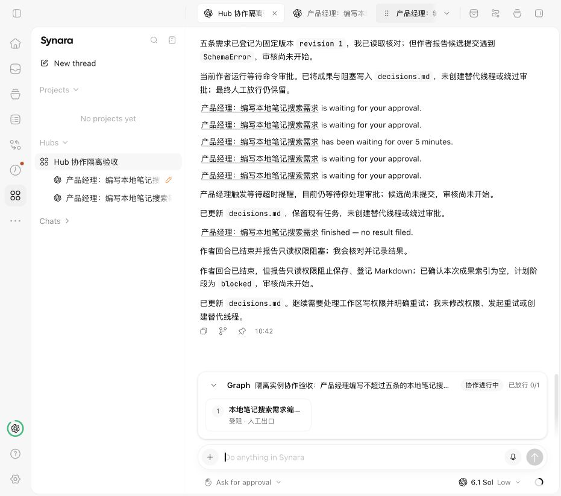

# Hub T1/T2 首轮实施验收

日期：2026-10-23。分支 `codex/feature-hub-collaboration`，基线 `93c751172091495c3b26991b92624cd6571a92fb`；变更尚未提交。产品与技术基线见 [评审入口](README.md#implementation-status)。

结论：配置与单活跃计划的首轮源码实现已完成自动化回归；真实模型链路尚未完成作者候选、审核、用户放行全流程，不标记正式业务验收通过。不涉及安装、发布或日用实例迁移。

## 已实现范围

- 专家团配置及版本冲突保护、可选协调方式、当前 Hub 配置副本和来源追溯。
- 计划提案与用户确认；复用原生 Goal、Task、Attempt、Work、Provider 和队列，事务内保存事件、幂等回执及调度 outbox。
- 固定版本作者候选、专业审核、人工出口、退回轮次与暂停恢复；不把 Provider 回合结束视为业务完成。
- 输入框上方只读横向 Graph；具体操作进入消息流，历史卡保留历史快照，旧卡、旧版本、断线和跨连接操作受保护。
- 缺少业务结果的已结束回合允许用户显式重试，保留旧 Attempt、Work 和证据；重新校验当前绑定后建立新尝试，不自动重试或提前派发审核。

这次实际联调还修复了：RPC 事件快照编码丢失、成果元数据工具声明不完整、Worker 监视更新覆盖结果证据的竞态，以及协调者重复渲染导致消息流布局循环的问题。成果元数据字段为 `workerThreadId`，读取选择器仍使用 `ownerThreadId`，两者不能混用。

## 自动化验证

所有命令使用仓库配置的 `mise exec -- bun`。测试运行器为 `bun run test`。完整回归和最后修改后的定向验证分别列示，不把不同时间的测试次数相加。

| 检查                 | 结果与边界                                                                                                       |
| -------------------- | ---------------------------------------------------------------------------------------------------------------- |
| 格式、lint、类型     | fmt:check 通过；lint 0 错误、1,054 警告，未宣称全部警告均为既有；typecheck 7/7 通过                              |
| contracts 完整回归   | 30 文件、254 测试通过；新增计划契约后另有 10 项定向通过                                                          |
| shared 完整回归      | 104 文件；1,114 通过、2 跳过                                                                                     |
| scripts 完整回归     | 45 文件、435 测试通过                                                                                            |
| desktop 完整回归     | 116 文件通过、2 文件跳过；1,444 测试通过、6 跳过                                                                 |
| web 完整回归         | 477 文件通过、3 文件跳过；5,576 测试通过、3 跳过；后续修改另做定向验证                                           |
| server 最终完整回归  | 629 文件通过、8 文件跳过；9,080 测试通过、29 跳过；2026-10-23 10:31 开始，12 分 42 秒完成，退出码 0              |
| 结果保留与 SQL 竞态  | ProjectAgentService 112 项、真实 SQLite Repository 20 项通过                                                     |
| 显式重试             | 计划服务、Graph、执行宿主 34 项通过；独立复核另验证 blocked review 不允许重试                                    |
| 消息流与重试 UI      | 重试操作 browser 17 项、逻辑 9 项通过；消息流 browser 2 项覆盖长消息流更新、无关父级重渲染、脱离底部后的阅读锚点 |
| 迁移定向回归         | 52 项通过；保留已运行迁移的校验摘要，未通过重写数据库绕过迁移校验                                                |
| 宿主边界             | 81 个源文件通过；不代表运行时完全隔离                                                                            |
| 迁移谱系             | 已钉住上游目录、冻结迁移 111、92 个发布标签的迁移身份检查通过                                                    |
| Windows 边界静态检查 | 318 个应用文件、119 个边界文件、4 个依赖补丁、9 个工作区清单通过；未验证 Windows 安装包运行                      |

最初仓库总测试命令的 server 分支因重复 `--maxWorkers` 参数未启动；后改用 `bun run test -- --filter=@synara/cli --concurrency=1` 单独完成服务端全量回归。中间一次服务端回归与正在编辑的工具 schema 测试重叠，出现 1 项失败；冻结代码后的上述最终完整回归全部通过。没有将这两次失败运行改记为通过。

主要日志位于本机 `/tmp/hub-final-root-suite.log`、`/tmp/hub-final-server-suite-frozen.log`、`/tmp/hub-final-format-check.log`、`/tmp/hub-final-lint.log`、`/tmp/hub-final-typecheck.log`；临时目录清理后日志可能不再可用，本文件保留实际结果与限制。

## 真实模型与浏览器验证

隔离 home 为 `/tmp/synara-hub-collaboration-final-preview`，服务端 `19541`，前端 `5933`。测试 Hub 为 `b0995f07-76f9-4696-8587-0e131060f263`，成果目录仍位于 `/Users/wangyuelin/Documents/Synara/Groups/hub-b0995f07-76f9-4696-8587-0e131060f263`。日用配置未修改；只有此测试 Hub 的模型按用户授权使用 GPT-6.1 Sol。

| 步骤               | 实际结果                                                                                                                                        |
| ------------------ | ----------------------------------------------------------------------------------------------------------------------------------------------- |
| 专家团与 Hub       | 浏览器完成保存、采用副本、Hub setup 和连接                                                                                                      |
| 计划提议与修订     | 模型提交 `local-note-search-acceptance`，修订至 revision 2；确认前未派发作者                                                                    |
| 人工确认与首轮作者 | 用户操作卡确认后派发作者；模型写入并登记 `local-note-search-requirements.md` revision 1，但候选提交遇到 schema 错误；错误已修复并通过自动化验证 |
| 缺失结果显式重试   | 浏览器点击最新卡重试；持久化 `plan.retried`，stateVersion 4；新 author Attempt 与线程启动，旧记录保留，审核未派发                               |
| 第二次作者         | 在现有 Ask for approval 模式下运行；模型报告只读环境，未请求具体 Markdown 写入审批，最终仅提交阻塞进度；没有登记本次候选                        |
| 最终状态           | revision 2、stateVersion 4、generation 1；Graph `blocked`，放行 0/1，当前作者节点可显式重试；审核节点没有 worker/attempt                        |
| 消息流修复         | 同一真实协调者页面可重新进入，展示历史操作卡和当前 Graph；未再出现最大更新深度错误                                                              |

验证过程中，自动审批拒绝了读取私人 `MEMORY.md` 的请求，理由是超出已授权的 Hub 测试范围。该请求被拒绝，未修改权限或绕过审批。后续尝试在已结束作者线程补充测试范围，被当前 Attempt 启动保护拒绝；没有复用失效线程或创建额外替代工作来伪造成功。

## 尚未验收或未纳入本轮

- 真实模型完成候选提交、审核员读取固定版本、人工放行全闭环，仍需在正确的测试工作目录写入授权条件下验证。
- Hub 内定向回复、完整人机共创、运行中计划修订、多计划并行、完整 T3 并行汇合不在本轮范围；保留契约不等于已有专用交互。
- 创建沿用“容器 → setup”两步；前端以项目事件和可见状态下约 8 秒轮询刷新，不是新建独立推送通道。
- 未验证打包后 macOS/Windows/Linux 全平台运行、签名、升级、安装、发布。静态边界与 mock 测试不能替代这些结果。
