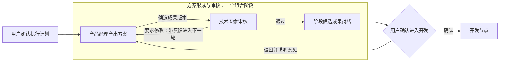
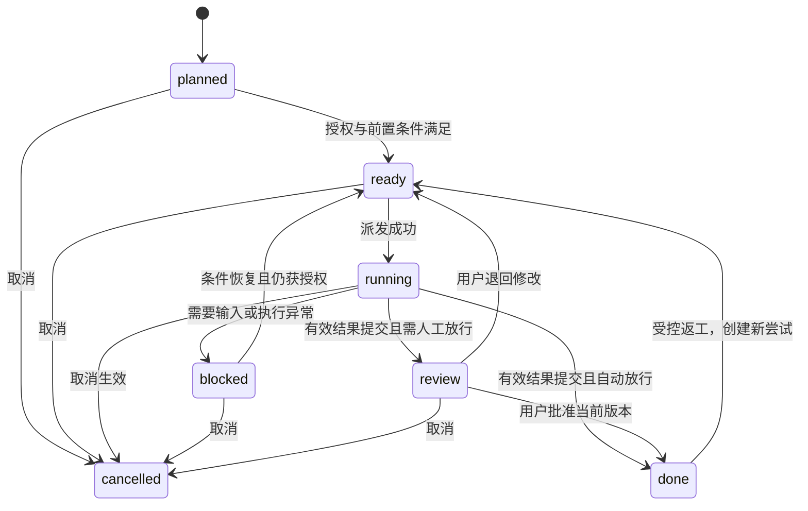

# Hub 专家团协作与任务编排 PRD

**版本：V0.3｜状态：供产品与技术评审的方案｜日期：2026-10-22**

代码基线：`WYLINX601/synara--expert`，`main@93c751172091495c3b26991b92624cd6571a92fb`。

本文在 V0.2 基础上，补齐专家团创建、Hub 角色边界和极简交互。保留已确定的 Graph、状态、Context 与人工放行规则，不要求接入新的工作流框架。

V0.3 复核了 Hub 配置契约；运行机制的代码依据沿用 V0.2 的固定版本。未验证当前产品完整创建页面，未运行端到端测试，也未修改应用代码。下文的界面、参数和交互是目标方案，不代表现有界面已经提供。

---

## 0. 本版决定与阅读方式

本版重点看第 1—5 节：先决定产品是什么，再确定如何创建、如何组织专业能力，以及用户如何看到和操作工作。第 6—13 节保留执行机制，第 14—17 节补齐开发对接和验收。

| 本次问题 | V0.3 决定 | 删去的额外复杂度 |
|---|---|---|
| 专家团与 Hub 的关系 | 一个 Hub 就是一支专家团的实际工作空间，可承载多份计划 | 不再增加独立 Team 对象及绑定步骤 |
| 专家团怎样创建 | 一个面板选择已有成员、确认名称；职责与背景按需补充 | 不要求先配 Graph、队长、技能包或一整套流程 |
| Hub 是否需要角色 | 固定的 Coordinator 职责＋团队方向；专业工作仍由 Expert 承担 | 不增加万能专家人设和 Coordinator 人设编辑器 |
| 如何极简地展示 | 主对话＋一个持续更新的工作卡＋已有专业线程 | 不新建永久 Graph 画布、团队驾驶舱或强制模式切换 |
| 如何修改团队 | 新工作使用新配置；已批准计划保持绑定，实质变化另行处理 | 不静默重规划，不因改名重新审批 |

### 0.1 继续沿用的五项原则

| 讨论问题 | 本版决定 | 不采用的设计 |
|---|---|---|
| 节点之间如何互动 | 区分控制依赖、输入引用和反馈消息。支持顺序、并行汇合，以及有上限的产出—审核闭环 | 不把双向讨论直接建成互相等待的前置依赖 |
| 计划是否信息过多 | 用户默认只确认目标、分工关系和阶段放行点。专业要求与背景继承已有配置，只记录本次差异 | 不强制每个节点填写一份完整任务说明书 |
| 谁负责交接 | 系统装配已有信息；执行线程只提交新成果、结论和阻塞；审核线程补充审核结论 | 不让 Agent 反复生成已有 ID、目标、角色配置与全部背景 |
| 人如何参与 | 工作方式只保留 Agent 主导、人机共创。Graph 控制节点或组合阶段的出口 | 不把每次提问、讨论和补充资料都设计成审批节点 |
| 任务与节点的状态 | 原子节点就是 Task，共用一个业务状态源。组合节点聚合子任务与放行结果 | 不为同一项工作再建立独立的 Task 状态和 Node 状态 |

**产品原则：最小化重复描述，不省略执行依据。Context 负责提供信息，Graph 负责约束推进，两者不能相互替代。**

## 1. 产品定位与范围

**一个 Hub，就是一支专家团的持续工作空间。** “专家团”是用户理解的组织形态，Hub 是承载它的产品空间；二者不是必须先后创建的两个对象。

这支团队可以处理多次讨论和多份工作计划。Expert 是可复用的专业成员，团队定义提供默认服务方向与共同背景，Graph 则规定本次工作的分工、依赖和阶段出口。创建团队不等于启动计划，配置成员不等于一次性授予其所有执行权限。

Hub 参考模板或自行设计适配的 Graph。用户确认计划后，系统按依赖和放行规则组织工作。

用户负责目标、必要决策和阶段验收。Coordinator 负责规划、路由和异常协调。Expert 负责专业讨论、产出和审核。运行层负责校验授权、推进状态、装配上下文和记录事实。

成功体验是：用户说明目标后，可以确认一份简洁的协作计划。团队在授权范围内自动协作，只在缺少必要输入或到达约定的阶段出口时请求用户处理。

本版优先覆盖“产品方案共创 → 专业审核 → 用户确认 → 开发”等有明确阶段的工作。单 Expert 讨论、单节点交付继续支持，不强制复杂编排。

### 1.1 可借鉴的成熟模式

| 需求 | 已有模式 | 本产品采用的部分 |
|---|---|---|
| 顺序接力、并行工作、汇合 | Chaining、Parallelization | 显式前置关系，汇合默认等待所有必要分支 |
| 产出者与审核者反复协作 | Evaluator–Optimizer | 审核通过则输出；要求修改则带反馈重做；设置终止条件 |
| 把一组协作作为一个阶段 | Subprocess／Subgraph | 内部包含多个任务，对外暴露统一出口和成果 |
| 共享背景与局部输入分离 | 变量作用域、输入／输出映射 | 引用共享信息，只映射当前工作所需的差异 |
| 人工确认后恢复 | Human-in-the-loop interrupt | 持久化待确认状态，收到有效决定后再推进 |
| 组合阶段的状态 | 层级状态机 | 子任务状态与阶段控制状态分层，不重复维护同一业务事实 |

这些模式分别可见 Anthropic、LangGraph、Camunda 和 Stately 的官方资料。[S1–S6] 本 PRD 只借鉴语义，不据此要求引入这些框架。

### 1.2 现有代码可复用的基础

仓库已定义 `ProjectGoal`、`ProjectTask`、`dependsOnTaskIds`、`ProjectTaskAttempt` 和 `ProjectEvidence`。此外还有 `HubWorkRecord`、Expert 输出要求、Context 快照、原始用户消息解析和版本化成果。[R1–R7]

因此，改造重点是把已有对象接成一个可靠闭环，而不是再创建完整的平行任务系统。特别要区分 `ProjectTask.status` 的业务状态与 `HubWorkState` 的调度状态。

---

## 2. 对象模型：尽量沿用现有概念

| 用户概念 | 目标语义 | 与现有代码的关系 |
|---|---|---|
| 专家团／Hub | 有成员、服务方向和共享背景的工作空间 | 复用 Hub 元信息与 `ProjectAgentConfig`，不单独增加 Team 生命周期 |
| Expert | 团队引用的可复用专业配置 | 复用 Expert 定义；同一专家在不同线程的工作历史不自动共享 |
| 执行计划 | 本次目标、Graph、确认范围及版本 | 优先扩展 `ProjectGoal` 作为内部工作容器；UI 不要求用户先创建 Goal |
| 原子节点／任务 | 一个 Expert 主责的工作 | 对应 `ProjectTask`，只有一份业务状态 |
| 组合阶段 | 一组任务的对外协作单元 | 增加受限的组合节点类型；MVP 只开放“产出＋审核” |
| 执行尝试 | 任务某次实际执行或返工 | 复用 `ProjectTaskAttempt`，增加必要的结果与输入关联 |
| Thread | 持续对话与执行历史 | 复用现有线程；任务和线程不是同一个对象 |
| 成果 | 文件、对话结论或可核验结果 | 复用版本化 Deliverable 与 Evidence 引用 |
| 放行决定 | 用户批准某版成果进入指定后续范围的事实 | 记录实际用户、计划版本、成果版本和操作时间 |

模板中的节点只是静态定义，没有运行状态。实例化计划时，由系统生成本次 Task ID，并保留模板节点到 Task 的映射，避免多次使用模板时串线。

**单一事实源约束：** 已实例化 Graph 中的原子节点 ID 使用 Task ID。边可以由任务依赖字段形成，但不可同时维护两套可写的依赖。组合节点的显示状态可以缓存，必须能由子任务、当前轮次和放行记录重算。

### 2.1 Thread 绑定规则

同一任务的共创、初稿、返工优先续用同一线程。不同阶段只有在主题连续、Expert 配置兼容且没有并行执行冲突时，才能复用线程。相同 Expert 不等于必须使用相同 Thread。

一条线程同一时刻只接受一个受编排的活动工作单元。审核任务与被审核任务使用不同线程；标注“独立专业审核”时，还必须检查角色和能力是否满足独立性，不静默用作者线程自审。

多个任务复用同一线程时，派发消息标明当前 Task 和输入版本。成果集合目前按线程归属，任务关联必须进一步记录本次提交所选的具体路径和 revision，不能把该线程历史成果一概算作本次输出。[R3]

---

## 3. 模块一：创建专家团，而不是配置一个新系统

### 3.1 创建入口与产品形态

**创建专家团，就是创建一个带有成员和职责的 Hub。** 不再新增独立的 Team 管理页，也不要求先创建团队、再创建 Hub、最后再绑定二者。

统一使用现有 Hub 新建入口承载创建。在面向用户的产品文案中称为“创建专家团”；Hub 保留为工作空间和内部概念。不能同时提供两个功能相同的“新建 Hub”和“新建专家团”入口。

创建使用一个弹窗或侧面板，不做多步向导。用户从已有 Expert 中选择成员；没有合适成员时复用 Expert 创建入口。团队创建不负责重新编辑成员的角色提示词、技能、工具或模型。

### 3.2 最小创建表单

| 信息 | 默认展示与填写规则 | 保存与校验 |
|---|---|---|
| 团队名称 | 必填；可根据职责或已选成员生成，用户可改 | 保存为 Hub 的显示名称，不另造一份团队名称 |
| 成员 | 必选；选择已有 Expert，以名称与专业摘要展示 | 至少 1 位，不强制 2 位；引用 Expert ID，不复制定义 |
| 团队职责 | 可选的一句话，例如“协助我完成产品探索、评审和交付” | 复用 Hub 级 `goal` 语义；与本次执行计划的 objective 分开 |
| 项目背景 | 只显示一条来源摘要；从项目内创建时预选当前项目 | 用户可更改或不绑定；全局入口不得猜测一个项目作为来源 |

一个成员也可以成立，后续再添加其他专家。不为了“专家团”的名称强制用户凑齐多个角色。

项目背景为条件项，不要求重新抄写项目目标和全部 Context。选择来源表示授权读取既有可访问背景，不代表授权修改项目、扩大工具权限或启动任务。

模型、并发、运行目录、成员的 Skill／MCP 配置和协作模板，不进入必填创建表单。沿用现有默认值；任务执行需要额外信息时再提示。

表单示意：

```text
创建专家团

团队名称    产品团队
成员        产品经理  技术专家                 ＋ 添加
团队职责    协助完成产品探索、评审和交付        可选
项目背景    Linx 项目                          更改

                                    取消  创建并进入
```

“创建并进入”只创建空间和配置，不创建正式工作计划、不启动 Worker，也不默认获取新权限。

### 3.3 成员选择与建议

成员选择器优先展示现有专家，支持按名称和专业摘要搜索。只显示选人所需的信息，不把每个成员的配置项全部展开。

填写职责后，可以提供一次可选的“推荐成员”。推荐只能选择真实存在且用户有权使用的 Expert；不能把模型生成的角色名显示成已经可用的成员。MVP 的必要能力是手动选择，智能推荐不是完成创建的前置条件。

当没有任何 Expert 时，显示“先创建一位专家”，进入既有 Expert 编辑流程；返回后保留团队草稿，并选中刚创建的专家。没有合适专家时允许先用现有成员创建，不强制当场补齐整支团队。

成员暂不可用时标出具体原因，例如模型未配置、必需工具未连接。允许保存团队配置，但不能显示“全部可用”。实际计划不得静默分派给不可用成员；应补齐能力、换人或修改计划。

### 3.4 创建流程与失败反馈

```text
打开创建面板
→ 选择成员，确认名称；可补充职责和背景来源
→ 服务端校验引用与创建权限
→ 保存 Hub 与成员配置
→ 进入新 Hub 空白主对话
→ 用户开始讨论或提出工作
```

创建使用同一请求标识去重。重复点击或网络重试不产生多个 Hub。任何必要配置保存失败时，不把残缺对象展示为“创建成功”；允许重试，并保留已填写内容。存储层采取事务还是可恢复提交，由技术方案决定。

与成员可用性检查区分：引用不存在、无读取权限属于保存错误；真实存在但当前工具离线属于能力提示，不等于团队配置无法保存。

### 3.5 首次进入

只呈现一行职责摘要、成员入口和输入框。可放最多两个与团队能力相关的示例请求，点击后填入输入框，由用户发送，不自动执行。

不展示空 Graph、不强迫选择协作模板、不要求建立第一份 Goal，也不显示一整页“如何使用多 Agent”的教程。用户直接讨论专业问题时，路由至相关 Expert；提出正式交付时，才进入计划确认。

### 3.6 配置复用的边界

MVP 复用 Expert 和协作模板，不建立额外的“团队模板市场”。有真实复用需求后，可增加“复制团队配置”：只复制名称草稿、职责和成员引用；不复制对话、计划、审批和执行记录。背景来源需再次确认，不能默默继承其他项目的数据范围。

---

## 4. 模块二：团队定义与 Hub 的协调职责

### 4.1 Hub 需要职责，不需要第二套专业人设

**Hub 需要固定的 Coordinator 职责，再用团队定义限定服务范围；不需要额外创建一个“万能 Expert”。**

| 层级 | 负责什么 | 是否需要用户新配置 |
|---|---|---|
| Coordinator 基础职责 | 理解需求、选择专家、规划 Graph、组织交接、跟踪异常、请求阶段确认 | 系统内置，不作为创建必填项 |
| 团队定义 | 这支团队主要帮助用户做什么，包含哪些成员，共享哪些背景与约定 | 复用名称、职责、成员和已有 Context／共同约定 |
| Expert 专业身份 | 专业方法、资料、工具、产出规范与判断 | 复用已有 Expert 定义，不在 Hub 内复制 |

Coordinator 可以说明进展、解释分工、整理明确的讨论结论。涉及专业取舍时，应委托相应 Expert，或组织交叉评审；不能因为团队名叫“产品团队”，就自行替代产品经理讨论所有产品问题。

团队职责可以影响路由和计划建议，但不能取消人工出口、跳过权限检查或改变已批准范围。不能把所有成员的 persona、Skill 和工具配置拼成 Hub 的超级提示词。

MVP 不提供独立的“Coordinator 人设编辑器”，不要求选择“团队队长”，也不新增一套 Coordinator 技能包。现有高级模型设置可以保留在原位置，但不作为团队身份。

### 4.2 团队定义具体影响哪些行为

| 输入或场景 | Coordinator 应采取的行为 | 不应采取的行为 |
|---|---|---|
| “这个产品的目标用户是否准确？” | 使用团队中相关的产品 Expert，优先续用对应主题线程 | 用自己的通用回答冒充产品 Expert 已参与 |
| “目前做到哪里了？” | 读取计划和工作状态，直接汇报关键进展与阻塞 | 为状态查询新建专业任务 |
| “把方案推进到开发” | 根据目标、现有讨论、成员能力与模板形成可确认计划 | 因已创建团队而默认获得执行授权 |
| “两位专家意见不同” | 明确分歧、组织针对性复核；涉及目标取舍时请求用户决定 | 仅凭 Coordinator 自信选择一个专业结论 |
| 缺少所需专业能力 | 指出缺口，提出补充成员、换人或缩小范围 | 捏造专家、暗中扩大成员权限或无提示替代 |

职责不必写得很长。它提供团队默认方向，不替代每份计划的本次目标。已有共同约定继续使用原有指令／Context 入口，避免新增一份重复的“团队 Prompt”。

### 4.3 一个成员与设置面板

Hub 顶部保留一个“成员与设置”入口。面板默认只展示名称、职责、成员列表和背景来源摘要；用户可在这里添加或移除成员。

专家的技能、工具、模型和角色详情通过“查看专家”进入既有 Expert 编辑器。没有必要在团队面板再次提供全套编辑能力。专家可用于多个 Hub 时，编辑前应说明这是共享 Expert 配置，不是本团队的独立副本。

项目背景和共同约定同样引用现有来源。只说明来源、可用状态及必要的版本差异，不重复铺开完整内容。对当前执行的实际影响，通过计划变更入口处理。

### 4.4 配置变更的生效范围

| 变更 | 默认影响 | 对已确认计划与运行线程的处理 |
|---|---|---|
| 名称、图标 | 立即更新显示 | 不触发重规划或重新授权 |
| 团队职责、共同约定 | 影响后续路由和新计划；按已有 Context 机制加载 | 不静默改变已批准任务；相关改变作为差异同步并评估范围影响 |
| 添加 Expert | 可用于后续分工 | 不自动把已有工作拆给新成员 |
| 从团队移除 Expert | 停止新的分配 | 先提示仍被使用的计划；默认保留已批准绑定。要停止其当前工作，应显式暂停或取消 |
| Expert 配置升级 | 新绑定使用当前可用版本 | 已有绑定保留快照；迁移时明确差异，不假定实时全量同步 |
| 更换背景来源 | 新计划使用新来源 | 运行中仍按记录的来源与输入工作；需要切换时走受影响计划的变更流程 |
| 实际权限撤销或工具不可用 | 立即按真实权限处理 | 不因“已有绑定”继续执行；显示阻塞。成员移除不等于权限撤销 |

对已批准计划中的后续任务，保留其被批准的成员和版本约束。新增任务不沿用旧成员的隐含授权。既有快照失效或底层权限被撤销时，应阻塞，不静默换人。

保存设置时保留预期版本检查。并发编辑产生冲突时，显示冲突并重新载入差异，不能由最后一次保存覆盖另一个明确决定。

---

## 5. 模块三：极简工作界面与完整交互闭环

### 5.1 默认产品形态

**主对话是入口，工作卡是进度与决策载体，已有 Thread 是深入工作的入口。** 不新增永久显示的 Graph 画布或独立的团队驾驶舱。

MVP 只需要三个界面区域：

| 区域 | 常态展示 | 按需展开 |
|---|---|---|
| 顶部 | 团队名称、成员与设置入口 | 团队职责、成员配置、背景来源 |
| 主对话 | 用户交流、Expert／线程关联、关键结果通知 | 被引用的讨论与历史 |
| 工作卡 | 当前工作的目标、阶段、状态和需要用户处理的动作 | 子任务、Graph 关系、执行依据与历史 |

团队职责只在空状态或设置中完整展示，不在顶部、欢迎语和每张卡重复。成员入口使用头像／数量或文本之一，不再同时堆叠“团队人数”“在线人数”“专家数”等没有决策价值的指标。

不新增“讨论／执行／协调”强制模式切换。用户自然表达；系统在真正派发前用计划确认消除执行歧义。

### 5.2 主界面文字线框

以下是布局与信息层级说明，不是另建一个界面原型。

```text
产品团队                                    成员与设置

用户：完善这个方案，技术审核后我来确认，再进入开发。

┌ 产品方案到本地开发                     待确认 ┐
│ 方案共创与审核   产品经理 ↔ 技术专家            │
│   完成后需你确认，才进入开发                  │
│ 本地开发         开发专家                    │
│ 不包含：发布上线                            │
│                                            │
│ [确认执行]   调整计划   查看详情              │
└────────────────────────────────────────────┘

输入问题、补充要求或要完成的工作……
```

卡片可随状态更新，但它始终对应同一个计划。无当前工作时只保留自然对话，不显示空列表、空进度条或空 Graph。

### 5.3 一张工作卡贯穿生命周期

工作卡是既有计划与 Task 的显示视图，不是新的业务对象，也不额外保存一套可写状态。卡片身份使用计划 ID，版本、状态和按钮可用性从实际记录派生。

| 场景 | 用户看到什么 | 主动作与后续行为 |
|---|---|---|
| 计划草案 | 目标、分工关系、人工出口、实质范围差异 | “确认执行”；确认指定版本，不自动跳转 |
| 已确认，等待资源 | 已接受的计划和真实排队原因 | 不强设主按钮；允许查看详情、暂停或取消 |
| 执行中 | 顶层阶段状态、当前负责人 | 点击阶段可进入相关 Thread；不要求用户点击“继续”维持运行 |
| Thread 等必要输入 | “产品经理需要你补充目标用户” | “去回答”；进入既有 Thread，回答不等于批准下一阶段 |
| 阶段等待放行 | 指定版本成果、审核结论、确认后的动作 | “确认进入开发”等具体动作；退回修改为次级动作 |
| 明确异常 | 阻塞原因、影响范围、可处理事项 | 根据原因显示“补充连接”“查看分歧”等；不统一叫“重试” |
| 已完成 | 最终成果与简短结论 | “查看成果”；详细阶段默认收起 |
| 已暂停或取消 | 当前事实、未停止操作或已有副作用的必要说明 | 暂停可“恢复”；取消不提供沿用旧授权的一键续跑 |

“已接受”“已排队”“正在执行”不能互相混用。模型在生成文字时也不能提前声称运行已经开始。

同一张卡每个状态最多一个主动作。其他动作放在次级链接或菜单中，不为整齐而保留无用按钮。存在多个独立待处理项时显示数量并在详情列出，不能用一个“继续”批量批准不同事项。

### 5.4 Graph 怎么展示，怎么调整

默认用阶段列表，不展示技术节点 ID、所有边和全部运行细节。

顺序以自上而下的阶段表达；并行分支归入同一行组，注明全部完成后汇合；“产出＋审核”折叠为一个阶段，显示两个专业角色和当前轮次。只有实际需要人工放行的出口才显示确认标记。

点击阶段展开子任务、输入、输出及对应线程。完整依赖仅在“查看详情”中以只读结构查看，不提供拖拽连线、自由节点类型和表达式编辑器。

用户通过自然语言调整计划，例如“先做方案，不开发”“把审核交给另一位专家”。Hub 更新草案并显示实质差异。运行中的调整按原有变更规则处理，不因使用聊天修改而绕过版本确认。

已在 V0.2 定义的顺序、并行汇合和受限 review_group 仍是唯一的 MVP 编排模式。UI 的阶段分组不额外创造可执行的组合类型。

### 5.5 进入 Thread 与返回 Hub

新建、续用或完成 Thread 都不自动改变当前界面。用户在卡片或已有线程列表主动进入。

Thread 顶部复用现有区域展示一个紧凑的任务关联：`产品方案 / 方案共创与审核`，点击可回到对应计划。没有绑定正式任务的讨论线程，不强加任务标签。

用户正常提问和补充信息仍使用原输入框。为计划出口确认显示专门动作；不在每次普通发言旁添加“审批”按钮。

从 Hub 进入 Thread 后，返回应恢复先前工作及滚动位置。具体消息如何在 Hub 与 Thread 双向投影继续沿用现有机制，本版不新增两份独立专业对话历史，也不建设多头像轮流发言的群聊界面。

专业线程产生的结果、有效变更和真实用户确认，统一更新原任务和原工作卡。Graph 的约束不能因用户从另一个入口操作而失效。

### 5.6 多份工作与通知

一个 Hub 可以同时承载多份工作，不因此要求拆成多个团队。默认展示当前用户选择的工作；有其他活跃工作时，在工作区域提供简短切换入口，不另开“计划管理中心”。

没有当前选择时，可优先提示需要用户处理的工作。用户已在阅读另一份工作时，只显示待处理数量，不抢占当前焦点。

输入“继续”“确认这版”等短句时，必须结合当前关联对象和实际用户消息判定。对计划或版本有歧义时先指出候选对象；不能仅靠模型猜测、旧卡片文本或隐藏焦点完成授权。

进度更新直接反映在卡片，不每一步发一条新消息。需要用户处理、显著异常和最终交付可以产生新通知，并指向原卡片。首次派发简短回执只需一次。这样保留时序，又不复制多个可操作的计划。

卡片展示当前视图；历史确认版本、关键变更和执行记录保留在“执行记录”中，不能随着卡片更新被覆盖。旧通知中的确认动作应重新检查版本，过期时引导查看当前状态。

### 5.7 精简不能削弱的交互约束

动作提交期间禁用重复点击，失败时保留内容和可重试的操作标识。敏感状态由服务端响应后确认，不用乐观 UI 提前显示“已放行”。断线时标出状态尚未刷新，恢复后重新核验。

退回修改必须携带可执行意见，复用输入框或卡片内单行展开，不弹出大型验收表单。单纯“暂不处理”保持等待，不生成拒绝记录。

状态同时用短文本与图标表达，不仅依靠颜色。按钮可以通过键盘操作；不使用 hover 才能发现的关键批准入口。详情按需展开，关键范围和确认后果不可被折叠隐藏。


---

## 6. 模块四：用户提出需求，Hub 形成计划

### 6.1 用户体验

用户可以直接说：“产品经理先把需求想清楚，请技术专家审核，我确认后再开发。”

Hub 优先使用已有关联讨论和项目背景。只有缺失信息会改变范围、分工或阶段出口时，才追问。普通专业讨论仍交给对应 Expert，不要求先生成完整 Graph。

当用户提出正式交付或持续协作要求时，Hub 形成计划草案。存在合适模板则参考；不存在则自行设计。裁剪模板不会扩大权限，也不能删除系统强制的安全限制。

### 6.2 计划默认呈现的信息

| 信息 | 展示方式 | 录入责任 |
|---|---|---|
| 本次目标 | 一句话说明做到哪里；必要时加一个范围差异 | Hub 根据用户原话整理，用户确认 |
| 工作安排 | 节点名称、Expert、顺序／并行／审核关系 | Hub 生成；用户可调整 |
| 人工放行点 | 标出“这里完成后等我确认” | Hub 提议，用户确认 |
| 额外要求 | 仅在本次有特殊约束、权限变化或能力缺口时展示 | Hub 引用已有要求或补充差异 |

默认不展开角色提示词、工具配置、全部上下文、技术 ID 和完整验收清单。它们可在“执行依据”中查看。

计划示例：

> **目标**：形成可用于开发的产品方案，再完成本地开发；不发布上线。  
> **安排**：产品经理共创方案 ↔ 技术专家审核 → 开发。  
> **需要你**：方案阶段通过后，由你决定是否进入开发；最终开发结果由你确认。  
> **操作**：主操作“确认执行”；次级操作“调整计划”。只授权当前阶段可通过调整范围表达，或在确认详情中选择。

### 6.3 最小参数

| 参数 | 必需性与默认值 | 说明 |
|---|---|---|
| `objective` | 必需，Hub 生成 | 本次目标；不能只用宽泛的 Project Goal 代替 |
| `nodes` | 必需，至少一个 | 原子任务或组合阶段 |
| `dependsOnTaskIds` | 默认空数组 | 运行依赖；由 Graph 关系生成，不要求用户填写 ID |
| `releasePolicy` | 确认前必须解析为 `auto` 或 `user` | 每个对外出口的放行方式；界面只强调 `user` |
| `scopeDelta` | 可选 | 与共享背景不同的本次范围约束 |
| `templateRef` | 可选，系统填充 | 记录模板来源；不是执行权限 |
| `planRevision`、来源、身份 | 系统生成 | 用于确认、审计与并发校验 |

原子任务最少需要 `brief` 和 `expertId`。`brief` 同时表达工作与预期结果，例如“整理本次功能的 PRD 草稿”，不再强制拆成目标、输出描述、验收描述三段。

`workMode` 为 `agent` 或 `co_create`，默认 `agent`；用户明确要求一起讨论时使用 `co_create`。该值决定协作策略，不决定是否放行。

### 6.4 对信息冗余的具体处理

| 信息 | 本版处理 | 为什么 |
|---|---|---|
| Expert 的方法、技能、工具与通用输出要求 | 继承 Expert 快照，不重复生成 | 已有 `persona`、`outputRequirements`、skills、references 等字段 [R4] |
| 项目背景与共同约束 | 引用 Context，不复制为节点字段 | 已有版本和加载状态；避免产生多份要求 [R5] |
| 本次任务与预期结果 | 在 `brief` 保留 | Expert 知道怎么做，不等于知道这次做什么 |
| 执行依赖 | 必须显式保存 | 通用角色配置和自然语言 Context 不能充当可校验的调度条件 |
| 输入正文 | 不手动重复 | 由系统按引用装配 |
| 输入选择 | 默认继承直接前序的输出；有歧义时增加引用绑定 | “有文件”不等于“本次使用这版文件” |
| 专业验收细则 | 默认继承；仅补充本次差异 | 不要求每个任务重复填写通用质量标准 |
| 完成与放行规则 | 必须明确 | 必须知道由谁、依据什么事件，允许后续开始 |

人的主观判断可以不写成评分量表，但仍要记录他确认的是哪版成果、允许进入哪一步。自动接力至少需要有效成果或结果引用，不能仅凭“我做完了”。

---

## 7. 模块五：用户检查分工与节点协作关系

### 7.1 关系分为三层，不新增三套工作流

| 层 | 回答的问题 | 最小载体 |
|---|---|---|
| 控制关系 | 谁在何时可以执行 | 前置 Task／组合阶段及其放行结果 |
| 数据关系 | 读取什么内容、哪一版 | 输入引用与上游输出引用 |
| 协作消息 | 要问什么、反馈什么 | 当前阶段内的结构化提问、答复或审核反馈 |

三层是语义区分。MVP 不要求三个图编辑器，也不要求把每条聊天消息画到 Graph 上。

**A 需要 B 的反馈，不等于 A 的首次启动必须等待 B 完成。** 产出—审核闭环使用条件反馈和下一轮执行，不建成 `A dependsOn B` 与 `B dependsOn A` 的双向前置依赖。

### 7.2 MVP 支持的三种编排模式

| 模式 | 用户理解 | 执行规则 | 主要参数 |
|---|---|---|---|
| 顺序接力 | A 完成并放行，再做 B | B 读取 A 已选定的输出 | `dependsOnTaskIds`；必要时 `inputBindings` |
| 并行与汇合 | A、B 分别完成，再由 C 接手 | 默认 `all`：所有必要上游已放行且输入可用 | 多个前置 ID；不额外存一份“并行关系” |
| 产出—审核组合 | 作者和审核者内部往返，对外作为一个阶段 | 审核通过后触发阶段出口；需修改则进入下一轮 | 作者、审核者、自动返工上限、阶段放行方式 |

MVP 不开放任意循环、任意 Agent 网络或“第一个返回即采用”的竞争汇合。确有业务需要时再扩展。

### 7.3 产出—审核组合阶段

默认折叠为“方案形成与审核”。展开后可见作者、审核者、当前轮次及对应线程。无需为每轮修改创建新任务卡或新 Thread。



上述回边是阶段内受控的返工，不是普通前置依赖。对外只暴露组合阶段出口。开发节点不能直接依赖内部作者节点，绕过审核和人工确认。

### 7.4 组合阶段参数

| 参数 | 默认／约束 | 用户是否常见 |
|---|---|---|
| `kind` | `review_group` | 显示为“产出＋审核” |
| `producerTaskId` | 一个作者任务 | 显示负责人 |
| `reviewerTaskId` | 一个审核任务 | 显示审核人 |
| `maxAutoRevisionRounds` | 继承 Hub 返工限制；当前契约默认值为 2 [R1] | 默认折叠；开始前可查看 |
| `releasePolicy` | 方案→开发场景建议 `user`，须在计划中确认 | 必须明确 |
| `reviewFocusDelta` | 可选 | 只写本次新增重点，不复制完整审核规范 |
| 对外输出 | 默认使用审核通过的作者成果版本 | 系统自动选择，不要求用户配置导出脚本 |

“2 轮”指首次审核后，最多再自动修改并提交两次，不是总共只审核两次。技术故障重试与内容返工分别计数，不能互相重置预算。

模板可以推荐不同上限，但需在本次计划中解析成确定值。已有 `maxRepairRoundsPerTask` 可作为默认来源；本组合阶段的计数不能与健康监控重试混用。

### 7.5 审核结果与双方讨论

审核线程只返回三个正式结论：`pass`、`revise`、`blocked`。

| 结论／动作 | 条件 | 系统行为 |
|---|---|---|
| `pass` | 明确指出审核的候选版本 | 阶段进入出口处理；不直接跳过人工放行 |
| `revise` | 必须给出可行动的问题或修改意见 | 自动续用作者线程，提交新版后重新审核 |
| `blocked` | 缺资料、存在重大分歧或超出权限 | 暂停该阶段的推进，说明责任方 |
| 提问／答复 | 审核需要了解理由，但尚未判定返工 | 在原有两个线程间路由问题；不增加任务或返工轮次 |

澄清消息记录问题 ID、提问来源、被讨论成果版本和答复引用。系统只在已批准的作者—审核者关系内转交。审核者等待答复，作者收到一个受关联的补充回合；答复完成后恢复审核。

澄清期间不并行派发作者返工。若作者提出需要修改成果，应转为正式返工流程，再提交新版。旧版审核不得用于新版。

连续澄清受 Hub 的自动续行与资源限制约束，不因“不算返工”而无限运行。超过限制或双方无法达成结论时交给用户，不生成假通过。

---

## 8. 模块六：用户确认计划并启动

### 8.1 交互

计划草案提供“确认执行”“只启动当前阶段”“调整计划”。确认不会自动打开或跳转到其他线程。

确认完整计划表示：允许按已展示的关系运行，并在所列人工出口停下。只启动当前阶段表示：即使该阶段完成，也不自动获得下游授权。

自然语言确认必须能唯一关联当前计划版本与范围。不能把“这个思路可以”自动解释成批准所有后续工作。

### 8.2 确认参数与校验

确认记录包含 `planId`、`expectedPlanRevision`、`authorizedScope`、`requestId`。实际用户身份、时间和来源由服务端生成，不接受 Agent 自报。

提交前检查：节点负责人可用；依赖无普通环；组合成员合法；不能绕过组合出口；必要输入能解析；人工出口明确；线程绑定无并行冲突；权限和资源策略有效。

模板或 Expert 配置在确认后变化，不静默修改当前计划。新信息先作为待采纳变化处理。

### 8.3 执行流程


“已确认”“已就绪”“已排队”“正在执行”应区分。不得把队列接受显示为已经开始。

重复确认应返回同一结果。相同 `requestId` 对应不同内容时拒绝，不重复派发。旧版确认返回版本冲突，呈现最新差异，不能默默套用。

---

## 9. 模块七：系统派发任务并装配 Context

### 9.1 用户体验

用户无需再次复制目标、背景或 Expert 人设。节点详情可查看简洁的“执行依据”：使用哪个 Expert 版本、哪些任务输入和哪些成果版本。

新任务开始或原任务续行时，只提示当前工作与负责人。只有资料缺失、配置不兼容或输入版本发生变化时，才需要突出提醒。

### 9.2 信息归属

| 信息 | 权威来源 | 谁负责带给 Thread | Thread 是否需要重新产出 |
|---|---|---|---|
| Hub、计划、Task、执行尝试、关联 Thread 的 ID | 运行记录 | 系统注入 | 否 |
| 本次目标、节点 brief、已确认范围 | 已确认计划 | 系统按引用装配 | 否 |
| 专业方法、Skill、工具与通用输出要求 | Expert 快照 | 复用现有 Expert 装载 | 否 |
| 项目背景、共享约定 | 已有 Context 与 Hub 信息 | 复用现有装载；记录使用版本 | 否 |
| 用户原始要求、附件和引用 | 已验证的原始消息 | 系统读取和解析 | 否 |
| 上游成果、审核意见 | 绑定的输出与反馈引用 | 系统选版并传递 | 否 |
| 当前任务的新成果 | 执行线程 | 线程提交，系统登记版本 | 是 |
| 新发现的问题、假设、阻塞 | 执行线程 | 仅提交新增信息 | 有发生时提交 |
| 审核结论及修改意见 | 审核线程 | 提交结构化结论与证据 | 审核任务需要 |
| 用户批准、用户身份和权限 | 真实用户操作 | 服务端记录 | 不允许 Agent 伪造 |

已有 `hubWorkSource.ts` 会解析原始用户消息，`renderHubWorkPrompt` 已能注入 work item ID。这类工作应由系统完成，不增加“Agent 手工写任务标识”的要求。[R6]

**不重复维护，不等于不给模型看到。** 共享信息在存储上引用一次；执行时仍需被注入或确保可读取。被上下文窗口截断、仅存在于索引、或无法访问，均不算已经交接。

### 9.3 最小输入绑定

默认装配：当前任务 brief＋已有 Expert／Context＋直接前序已放行的输出。组合审核者默认读取当前轮次作者提交的具体版本；作者返工默认增加对应审核反馈。

只有需要选择子集、引用非直接前序、使用用户指定版本或解决歧义时，才设置 `inputBindings`。如果某输入来自当前 Graph 中尚未完成的任务，同时必须存在相应的前置关系；不能只有资料引用却没有等待规则。

外部已发布成果可以只作为输入引用，不凭空增加任务依赖。版本在任务获准启动时解析并固定；后续恢复使用原绑定，不再次查询“最新”。

必须直接参与本轮判断的输入，应由系统注入或在执行前加载；补充参考资料才按需读取。“引用可用”与“已经读取”分别记录，不把资料可发现当作已读。

关键 brief、审批边界、必须遵守的约束和版本引用不得被静默裁剪。大文档可以按需读取；无法完整取得必要输入时应阻塞并说明缺口。

Context 快照相互冲突时，系统展示来源差异，不由模型静默选择。工具权限和系统安全限制不会被节点补充要求覆盖。

### 9.4 Thread 的最小结果提交

普通任务仅需提交一个或多个有效 `outputRefs`。成果可以是文件，也可以是被保存的对话结论；不强制每个节点生成独立文档。

`summary` 可用于用户预览，但不作为唯一交付依据。新增阻塞、假设、特殊注意事项仅在存在时提交。

审核任务额外提交 `verdict` 与 `reviewedOutputRefs`；`revise` 必须有修改意见，`blocked` 必须有阻塞原因。服务端从当前执行身份补全 Task、尝试、作者、时间等字段。

提交时验证：身份属于当前任务；尝试仍有效；成果存在且可访问；版本可固定；审核目标与当前候选一致。验证通过才进入业务状态迁移。Worker 一轮结束本身不等于提交。

---

## 10. 模块八：在 Thread 中持续工作与人机共创

### 10.1 两种工作方式

| 方式 | 用户体验 | Graph 的处理 |
|---|---|---|
| Agent 主导 | Expert 自主推进；缺必要信息时照常提问 | 不为每个问题创建节点；等待必要输入时反映阻塞原因 |
| 人机共创 | 用户与 Expert 在原线程持续讨论、选择和修改 | 同一任务持续运行；形成阶段成果后再检查出口 |

人机共创不是“每轮都要批准”，Agent 主导也不是“绝不能问人”。两者均可随时提出需要用户处理的问题。

节点内的常规提问继续使用 Thread 的输入等待机制。Graph 只需知道该节点是否能继续，不要求描述完整讨论流程。

### 10.2 用户在节点内作出决定

普通反馈在当前任务范围内生效。涉及正式范围、下游工作、权限或关键成果版本变化时，触发计划变更事件。

“这个方向不错”是讨论反馈，不自动放行阶段。“确认这版方案并进入开发”只有在能唯一匹配当前待放行对象、版本及已授权范围时，才可形成放行决定。无法匹配时，只补问所需的歧义，不重做整套审批。

当前来源解析针对 Coordinator 线程中的原始用户消息。[R6] 支持专业线程中的有效确认需要扩展服务端来源校验，不能把 Worker 转述的“用户已同意”当作用户身份。

### 10.3 未提交与异常结束

Thread 输出了问题后停止，显示“等待你的回答”。Thread 因网络中断停止，显示执行异常。Thread 声称完成却未形成有效结果，显示“结果未提交”，并在已授权重试限制内要求补齐。

三者都不自动将 Task 标记为完成。通过运行层识别的 `needs_input` 或明确结果事件确定状态，不仅靠文本关键词猜测。

---

## 11. 模块九：阶段完成后，用户决定是否进入下一步

### 11.1 放行规则的位置

`releasePolicy` 配置在原子节点或组合阶段的**对外出口**，而不是为每一条边重复配置审批，也不要求创建人工 Worker。

MVP 一个出口的人工决定作用于其所有已授权下游。只有部分下游需要审批的复杂场景，暂不提供逐边审批；通过调整阶段边界表达。

产出—审核组合中，作者提交给审核者自动推进。只有整体审核通过，才触发组合阶段的用户确认。

### 11.2 用户看到什么

待确认卡片只展示阶段名、候选成果、审核结论、关键风险，以及确认后将启动的下一阶段。用户可以展开详细记录或进入原线程继续讨论。

提供三个操作：

| 操作 | 输入 | 结果 |
|---|---|---|
| 确认并继续 | 当前成果与待启动范围 | 保存批准，启动符合条件的下游 |
| 退回修改 | 修改意见；有多个修改目标时再选目标 | 回到原作者线程；新版仍需审核和确认 |
| 暂不处理 | 无 | 保持待确认，不取消，不重复催促启动 |

“拒绝本阶段／取消工作”使用单独的取消操作，不与退回修改混为一谈。

### 11.3 放行记录

最小记录为：`scopeId`、`planRevision`、`outputDigest`、`decision`、`comment`（退回必需）、`requestId`。服务端补全用户身份与时间。

`scopeId` 指向本次任务或组合阶段。`outputDigest` 对应该阶段已经固定的结果引用集合，不只是“当前最新版本”。

批准的含义是允许基于这组成果推进，不等于保证内容没有任何错误。人可以负责专业预期判断，但系统仍须检查必要成果能否读取、下游是否有权限使用。

### 11.4 边界情况

旧版批准不能放行新版。批准后、派发前若目标输入变化，调度器再次检查并停止旧授权下的启动。

只批准当前阶段的用户，可在出口选择“确认结果”结束该阶段；进入未授权下游时必须另外确认新增范围。

出口自动放行不替代工具权限确认。节点运行中的高风险操作仍受现有工具审批和执行权限限制。

---

## 12. 模块十：用户查看进展、等待与异常

### 12.1 不建立重复状态机

**原子 Graph 节点＝Task。** 沿用 `ProjectTaskStatus` 的业务状态，不增加另一个需要双向同步的 Node 状态。[R1]

| 现有状态 | 产品显示 | 本版语义 |
|---|---|---|
| `planned` | 未就绪 | 计划未授权、前置未放行，或尚未进入本轮 |
| `ready` | 已就绪／排队中 | 可执行；是否入队由调度状态补充 |
| `running` | 进行中 | 正在执行或开展可继续的共创 |
| `blocked` | 等待处理／执行异常 | 用 `reason` 区分缺用户输入、缺权限、执行失败、超过限制等 |
| `review` | 待你确认 | 本节点或组合阶段已形成候选成果，等待其出口放行 |
| `done` | 已完成 | 当前有效成果已经满足本节点的完成和放行要求 |
| `cancelled` | 已取消 | 不再自动推进 |

审核 Expert 正在工作时，他的 Task 状态是 `running`，不是因为角色叫审核者就使用 `review`。当前枚举的显示语义需要统一，相关存量数据应兼容处理。

`HubWorkState` 继续表示 accepted／queued、starting、working、waiting 等调度事实。不得将其 `completed` 直接映射为业务 `done`。[R2]

### 12.2 关键迁移



`done → ready` 只允许在明确返工事件下发生，保留之前尝试和输出。已经完成整份计划后再修改，应创建经确认的修订，不静默复活旧运行。

因新输入使已提交结果失效时，记录失效原因并暂缓受影响下游，不能仅修改显示状态却继续派发。

### 12.3 组合阶段如何有状态

组合阶段需要可恢复的内部控制信息，但不再独立维护一份与子任务互相矛盾的完成状态。

阶段状态由当前轮次、作者尝试、审核结果、放行记录和阻塞情况聚合：尚未启动为 planned；内部执行为 running；审核通过且等待用户为 review；有效放行为 done；无法继续则 blocked。

审核任务成功返回 `revise`，表示“审核工作已完成”，不表示“该方案已通过”。组合阶段据此开启作者的新尝试，并让审核任务等待新的候选版本。

顶层计划的“等待”“部分异常”等是汇总视图。有独立分支正在运行时，不把整个计划误显示为完全停滞。

### 12.4 必须满足的派发条件

```text
canDispatch =
  计划及当前节点在有效授权范围内
  AND 计划、Hub、节点均未暂停或取消
  AND 所有必要上游在当前有效版本上已放行
  AND 所需输入已经固定且可访问
  AND 当前节点不存在待处理的失效或范围变更
  AND Expert／Thread 配置与权限满足本次工作
  AND 当前节点／线程没有冲突执行
  AND 并发及资源限制允许
```

检查在实际派发时完成，不能只在模型生成计划时检查一次。

取消进入系统控制后停止新派发，并请求终止可中断执行。无法立即停止的外部动作要显示“正在停止”及真实结果，不宣称已经回滚。

---

## 13. 模块十一：修改要求、返工与恢复

### 13.1 用户修改了什么

| 变化 | 默认处理 | 需要重新确认吗 |
|---|---|---|
| 节点内部措辞或实现方法 | 在原线程继续 | 不需要，除非触及已确认限制 |
| 作者按审核意见修订 | 新尝试＋新成果版本，再审核 | 在已批准返工额度内不重批计划 |
| 用户退回当前成果 | 原线程返工，保持明确范围 | 本次退回本身是修改指示；不自动扩张预算和权限 |
| 改变目标、交付范围、Expert、关键依赖或放行点 | 生成计划修订和影响说明 | 需要 |
| 新版成果影响已确认下游 | 旧结果保留，旧放行对新版失效 | 需采纳新版或决定继续旧版 |
| 临时工具／网络失败 | 按已有恢复策略处理 | 不重复确认原计划；无法判断副作用时先核验 |

工作模式调整仅影响讨论方式时可在原节点完成；若改变自动执行范围或必要人工出口，则进入计划修订。

### 13.2 返工及版本规则

内部审核未通过时，组合阶段不释放对外出口。保留 taskId 和 threadId，建立新的执行尝试。反馈指向被审核的候选版本，新结果使用新 revision。

超出自动返工上限后，展示失败原因、当前成果和主要分歧。用户可以追加一轮额度、调整要求或停止。追加额度必须记录授权，不能由 Agent 自行重置计数。

已放行的组合阶段被明确重新打开时，所有依赖旧出口的新派发暂缓。已运行的下游标记影响并在安全点处理；不得声称外部副作用可自动回滚。

### 13.3 重启与重复事件

持久化计划版本、有效授权、Task 当前尝试、输入与结果引用、组合阶段轮次和人工决定。

恢复后先核对当前真实执行状态，再决定恢复或派发。旧尝试的迟到回报只记入历史，不能覆盖新尝试。重复结果、重复审核和重复批准都应去重。

工作项入队、状态迁移和派发凭证需协调提交。不得假设一个 `requestId` 就天然实现所有外部操作的 exactly-once；副作用不明时应核验或请求人工处理。

### 13.4 控制边界

本版 Graph 保证的是纳入 Hub 编排的任务、接力与放行。独立于该运行的普通线程、用户手动改文件和不受控外部工具，不会因为存在 Graph 自动受到约束。

对绑定 Graph 的线程，受管理派发和相关写操作必须使用统一权限入口。已有的直接 create／send／task update 等路径不能成为越过依赖或人工出口的旁路。外部编辑被发现后应作为变更输入处理，不伪装成已同步。

---

## 14. 开发所需的最小产品契约

以下为建议语义，不是已存在的 API 名称。传输方式、数据库设计和技术命名由技术方案确定。

### 14.1 需要新增或扩展的信息

| 信息 | 最小内容 | 复用策略 |
|---|---|---|
| 计划版本与授权 | revision、authorizedScope、确认来源 | 扩展 `ProjectGoal`，不要另造平行 Goal／Plan 生命周期 |
| 原子节点规格 | brief、expertId、workMode、releasePolicy | 以 `ProjectTask` 为事实源 |
| 组合阶段规格 | kind、成员、返工上限 | 单层 review_group；无人工 Worker |
| 输入绑定 | sourceRef／sourceTask、选取范围、解析版本 | 复用 Context／Deliverable 引用，仅记录绑定差异 |
| 尝试结果 | outputRefs、必要摘要；审核时附 verdict | 扩展 `ProjectTaskAttempt`／Evidence |
| 放行记录 | scope、计划版本、结果摘要指纹、真实用户决定 | 不由 Agent 代写为 user-confirmed |
| 阻塞原因 | reason、责任方、可恢复条件 | 附在业务状态上，不增加大量状态枚举 |
| 协作往返 | questionId、目标线程、候选版本、replyRef | 限定在已批准组合阶段内部 |

最终解析规格可以包含更多技术 ID，但由系统生成。用户配置层和运行记录层不应共用一个长表单。

### 14.2 命令／事件语义

| 动作 | 谁可发起 | 必要输入 | 服务端必须保证 |
|---|---|---|---|
| `propose_plan` | Coordinator／用户编辑 | objective、节点与关系、所需差异 | 只生成草案，不派发 |
| `confirm_plan` | 用户 | planId、expectedRevision、scope、requestId | 核验真实身份，固定授权版本 |
| `submit_result` | 当前受委派线程 | outputRefs；审核附 verdict 与 reviewedOutputRefs | 自动关联 Task／尝试，拒绝跨任务提交和旧版审核 |
| `ask_peer`／`reply_peer` | 组合阶段成员 | 问题或答复引用、目标关系 | 验证允许的协作对，保持问题相关性，不触发完成 |
| `decide_release` | 用户 | scopeId、版本指纹、决定、requestId | 旧版不放行；退回有意见；重复操作不重复派发 |
| `revise_plan` | Coordinator 提案、用户确认 | baseRevision、差异 | 只变更确认范围，不静默扩大授权 |
| `pause/resume/cancel` | 用户或授权控制入口 | 计划／任务范围、requestId | 停止新派发；恢复时重新校验 |

对 Graph 管理的任务，外部不能用通用 `set_status=done` 跳过结果和放行检查。现有状态修改入口必须识别 managed 状态并应用同一规则。

所有变更命令使用幂等键及必要的预期版本。结果事件同时关联当前 attempt 和输入版本。数据、状态和派发记录需要一致更新；模型只提出行动，不直接绕过服务端判定。

### 14.3 与当前仓库的对应关系

| 已核对文件 | 当前基础 | 本版改造方向 |
|---|---|---|
| `packages/contracts/src/projectAgent.ts` | Goal、Task、依赖、尝试、证据与修复上限 [R1] | 增加计划确认版本、组合结构与明确的结果／放行关联 |
| `packages/contracts/src/hubWork.ts` | 入队、运行状态、原始消息、Expert binding [R2] | 与 Task／attempt 关联；只负责调度，不代替业务完成 |
| `packages/contracts/src/expert.ts` | persona、outputRequirements、技能、资料及快照 [R4] | 继承通用规范；不复制进每个节点 |
| `packages/contracts/src/context.ts` | Space／Project Context、快照及实际加载记录 [R5] | 复用装载；记录 Graph 本次使用的版本与差异 |
| `packages/contracts/src/hubDeliverables.ts` | 发布 revision、摘要、来源与历史读取 [R3] | 绑定 Task 结果、审核目标与人工放行的精确版本 |
| `apps/server/src/agentGateway/hubWorkSource.ts` | 服务端解析用户消息、装配派发提示 [R6] | 注入计划／Task 当前尝试；扩展线程内真实决定的合法来源 |
| `packages/contracts/src/agentGateway.ts` | 创建、等待、Expert 选择及幂等请求 [R7] | 在受管理派发入口增加计划授权与依赖检查 |
| `apps/server/src/projectAgent/projectBotPlaybook.ts` | 当前直接回答／续用／新建线程规则 [R8] | 专业讨论优先 Expert；正式委托先计划确认，避免与当前“立即派发”约定冲突 |

需要技术方案进一步核查现有 `ProjectGoal.authorizedAt`、task.accept 和默认并发设置的实际使用路径。契约中同时存在不同配置来源，不能仅读取一个默认常量就覆盖用户现有配置。

---

### 14.4 团队创建与工作卡的最小对接信息

以下是产品动作的参数语义，不是要求新建同名服务或已存在的接口签名。优先补齐现有 Hub 创建与配置接口。

| 动作／视图 | 必要信息 | 复用与约束 |
|---|---|---|
| 创建专家团 | 显示名称、expertIds；可选 goal 和 sourceProjectId；系统带 requestId | 名称落在现有 Hub 显示元信息；其余优先复用配置契约。用户不提供技术 ID 和模型路由 |
| 更新团队 | Hub ID、预期配置 revision、变更字段 | 服务端返回生效范围和受影响工作；不能顺便改写执行计划 |
| 成员选择器 | 现有 Expert ID、名称、专业摘要、可用性 | 能力可用性是实时检查结果，不把角色名称当作能力已经就绪 |
| 工作卡读取视图 | planId、planRevision、业务状态、顶层阶段摘要、待处理项、成果引用 | 从现有记录投影；禁止维护第二份可写卡片状态 |
| 阶段动作 | 原有 confirm_plan／decide_release／pause 等命令 | 复用身份、版本与幂等校验；按钮只是同一命令的入口 |
| 当前工作选择 | 当前用户选择的 planId | 只属于 UI 焦点，可会话保存；不能单独充当执行授权 |

`ProjectAgentConfig.goal` 表示团队的总体方向；`ProjectGoal.objective` 表示这次委托，不因字段都含 goal 而混为一个对象。角色配置仍在 Expert，团队共同规则仍在已有指令／Context 中。[R1、R4、R5]

现有配置包含 `expertIds` 与 `sourceProjectId`，但配置存在不等于当前创建界面已覆盖这些交互。本版不据此声称已经实现一键创建专家团。名称的具体持久化来源、创建事务边界与现有面板组件复用位置，需要技术方案核对。

---

## 15. 一条完整的目标体验

用户在“创建专家团”面板选择产品经理、技术专家和开发专家，确认团队名称，可选绑定 Linx 项目背景。点击创建后进入主对话，没有自动启动的 Worker。

用户：“和产品经理一起把方案想清楚，技术专家帮我审核，我确认后再开发。”

Hub 形成两个顶层阶段：`方案形成与审核`、`开发`。前一阶段内部包含产品经理共创任务和技术审核任务。方案出口和开发最终交付均需用户确认。

Hub 以一张工作卡显示计划。用户确认后，卡片更新为当前执行状态，产品经理线程开始讨论。用户可留在 Hub，也可进入该线程，系统不强制跳转。讨论期间的提问不会生成新审批节点。

产品经理提交方案 v1。系统转给审核线程。审核者询问一个技术假设，问题在两个原线程间往返；这不算一次返工。

审核者要求修改。作者在原线程形成 v2，系统重新审核 v2。审核通过后，组合阶段显示“等待你确认”；开发仍为未就绪。

用户查看 v2 与审核结论，选择“确认并进入开发”。系统固定 v2 的引用，复核授权和依赖，派发开发。用户不用重复转发方案。

团队名称或头像的修改只影响显示，不重新打断当前工作。团队增加一位新专家，也不自动改变本次已确认的分工。

开发过程中用户把目标用户从个人改为企业。系统将其识别为可能影响范围的明确变更，暂缓受影响工作，展示调整后的计划和差异；没有得到确认前不按新范围继续。

该体验中的任务 ID、Expert 版本、成果引用和上下文装配均由系统处理。用户只处理目标、专业取舍与阶段放行。

---

## 16. MVP 范围与实现顺序

### P0：一个完整、可控的闭环

先补齐一个团队创建面板与一个成员设置入口，复用现有 Hub 和 Expert。工作卡统一承载草案、进展、等待和成果，复用既有线程导航；不重做整个对话界面。

运行层先打通“计划确认 → 原子任务派发 → 结果提交 → 出口放行”。使用同一套 Task 状态和现有队列，确认不会绕过 Gateway。

再加入一个受限的 review_group：作者／审核者、受关联的澄清、最多指定次数的返工、审核通过后阶段放行。

同时完成输入与输出版本固定、专业线程中的变更回传、重启恢复、重复事件处理，以及错误版本批准的拒绝。

模板初期只做少量参考方案。无匹配模板时允许生成同样可校验的计划。顶层图保持无环，内部循环仅由 review_group 控制。

### P1：增加复用，不扩大控制面

用户保存成功计划为模板，比较计划差异，完善影响分析与协作统计。按真实需求增加成员建议、团队配置复制和其他组合模式；不把这些功能变成创建的前置要求。

### 暂不做

独立团队管理系统、Coordinator 人设编辑器、必填团队队长、团队模板市场、永久 Graph 画布、通用 BPMN 编辑器、任意循环和嵌套子流程、自由 Agent 群聊网络、多角色会签规则、复杂条件语言、逐边审批、全自动文件冲突合并，以及重新设计整个 Thread UI。

---

## 17. 验收用例

| ID | 场景 | 预期结果 |
|---|---|---|
| AC01 | 用户只询问产品定位 | 使用合适 Expert，不创建完整项目流程 |
| AC02 | 模板不匹配 | 能生成单节点或自定义 Graph，不强制套模板 |
| AC03 | 草案未确认 | 正式工作不进入派发队列 |
| AC04 | 两个标签页确认不同计划版本 | 旧版确认失败，不启动旧计划 |
| AC05 | 同一确认请求被重复提交 | 一次有效授权，不重复派发 |
| AC06 | 用户只授权方案阶段 | 方案完成后开发仍无执行授权 |
| AC07 | A、B 独立，C 依赖二者 | A、B 可并行；C 等二者放行 |
| AC08 | 产出者和审核者被画成互相前置依赖 | 计划校验拒绝，建议改为 review_group |
| AC09 | 开发直接引用组合内作者节点来绕过审核 | 计划校验拒绝跨越组合出口 |
| AC10 | 审核读取作者 v1 | 系统固定 v1，不在中途替换为最新版本 |
| AC11 | 审核要求修改 | 原作者线程新尝试；保留 v1 与意见，不新开无关联任务 |
| AC12 | 审核澄清后答复 | 恢复原审核，问题和答复关联，不占内容返工次数 |
| AC13 | 连续往返超过限制 | 阶段阻塞，显示分歧和可选动作，不无限运行 |
| AC14 | 审核通过，但阶段需用户确认 | 开发不启动，显示明确待确认卡片 |
| AC15 | 人机共创线程中用户说“方向不错” | 不自动批准阶段出口 |
| AC16 | 用户在绑定线程明确批准当前版本 | 经服务端身份与对象校验后，只放行对应范围 |
| AC17 | Worker 转述“用户已批准” | 不产生用户授权 |
| AC18 | Expert 已包含通用输出要求 | 节点不要求重复填写；运行依据显示继承来源 |
| AC19 | 必要 Context 未加载或成果不可读 | 不显示已经交接，阻塞并说明缺口 |
| AC20 | Worker 回合完成但没有有效结果 | Task 不进入 done；标记未提交或等待输入 |
| AC21 | 已批准 v2 后出现需采纳的 v3 | v2 的批准不能放行基于 v3 的执行 |
| AC22 | 旧尝试回报晚于新尝试 | 只保留历史，不覆盖新任务状态 |
| AC23 | 阶段审核未过，但审核 Task 成功返回 | 组合阶段仍未完成，按 revise／blocked 处理 |
| AC24 | 任一无关分支等待用户 | 其他已授权、条件满足的分支继续 |
| AC25 | 暂停后队列有待启动任务 | 不再新派发；恢复前重新校验 |
| AC26 | 服务重启时有运行中或已提交任务 | 先核验再恢复，不重复写入或重复接力 |
| AC27 | 通用状态修改工具尝试直接设 done | 对受管理任务应用结果／放行检查，不能绕过 |
| AC28 | 同一 Thread 被两个就绪节点同时选中 | 串行或重新分配经确认的线程，不并行污染上下文 |
| AC29 | 新节点引用尚未完成的同图任务成果 | 同时要求前置关系；不因仅有输入引用而提前启动 |
| AC30 | 已完成计划被要求增加新目标 | 新建修订并确认，不直接复活旧授权 |
| AC31 | 选择一位已有 Expert 创建团队 | 允许创建，不强制多个角色；不自动生成计划或启动 Worker |
| AC32 | 未选择成员提交创建 | 保留表单，提示选择／创建专家；不生成残缺团队 |
| AC33 | 全局入口未选择项目背景 | 允许先创建，不猜测并绑定其他项目 |
| AC34 | 重复点击创建或网络重试 | 返回同一个创建结果，不产生重复 Hub |
| AC35 | 已选专家暂缺工具连接 | 可保存配置且明确提示；相关计划不能假装具备能力 |
| AC36 | 用户在团队创建中跳去新建 Expert | 返回后保留草稿并选择真实创建的专家 |
| AC37 | 专业问题匹配已有成员 | 路由到相关 Expert；不把 Coordinator 通用回答标成该成员回答 |
| AC38 | 改团队名称或添加成员 | 不重批、不重派既有计划，也不自动扩大分工 |
| AC39 | 从团队移除仍被计划使用的成员 | 明示影响；不静默取消或换人，当前批准绑定按约定保留 |
| AC40 | 底层权限已撤销但线程快照仍在 | 阻塞相关执行，不能借旧绑定继续访问 |
| AC41 | 团队职责或背景来源发生变化 | 新工作使用新配置；旧计划需要的实质改变按变更流程处理 |
| AC42 | 计划从草案推进到执行、待确认和完成 | 同一工作卡投影更新，不制造多个可操作副本 |
| AC43 | 用户正查看专业线程时另一任务完成 | 不自动跳转，只更新状态或必要通知 |
| AC44 | Thread 等用户回答与阶段等批准 | 分别显示“去回答”和明确放行按钮；回答不自动批准 |
| AC45 | 多份计划都有待确认项 | 分清计划及版本；不能用含糊的“继续”批量放行 |
| AC46 | 从历史通知点击旧版确认 | 服务端拒绝过期版本，指向当前工作，不执行旧动作 |
| AC47 | 工作状态暂不可刷新或动作失败 | 显示真实未确认状态，保留输入，不提前显示已完成放行 |
| AC48 | 用户进入 Thread 后返回 Hub | 恢复对应工作与浏览位置；任务与计划记录仍是同一份 |
| AC49 | 卡片阶段很多或没有当前工作 | 分别按需折叠、隐藏空卡；不要求打开完整 Graph 才能操作 |


### 17.1 观测指标

记录重复派发次数、错误版本放行次数、必要输入缺失导致的返工、自动审核返工轮数、人工退回率及每阶段耗时。前两项在上述验收集合中必须为零。

新增观察团队创建完成率、创建后首次有效专业协作、能力缺口暴露次数，以及用户在阶段确认后退回修改的原因。其余指标先建立基线，不在没有真实运行数据时承诺具体改善百分比。

---

## 附录 A：计划规格示例

以下是本 PRD 的说明性规格，不是现有仓库已支持的请求体。字段中包含模板和系统可推导的值，用户不需要填写 JSON。

```json
{
  "planId": "plan-product-001",
  "revision": 1,
  "objective": "形成产品方案，经用户确认后完成本地开发；不发布上线",
  "nodes": [
    {
      "id": "solution",
      "kind": "review_group",
      "title": "方案形成与审核",
      "dependsOnTaskIds": [],
      "producerTaskId": "draft",
      "reviewerTaskId": "review",
      "maxAutoRevisionRounds": 2,
      "releasePolicy": "user"
    },
    {
      "id": "draft",
      "kind": "work",
      "parentTaskId": "solution",
      "brief": "与用户明确需求，形成用于开发的产品方案",
      "expertId": "product-manager",
      "workMode": "co_create",
      "dependsOnTaskIds": [],
      "releasePolicy": "auto"
    },
    {
      "id": "review",
      "kind": "work",
      "parentTaskId": "solution",
      "brief": "审核当前轮次方案的技术可行性与重大遗漏",
      "expertId": "technical-reviewer",
      "workMode": "agent",
      "dependsOnTaskIds": ["draft"],
      "releasePolicy": "auto"
    },
    {
      "id": "develop",
      "kind": "work",
      "brief": "依据已放行的方案版本完成本地开发并提交验证结果",
      "expertId": "developer",
      "workMode": "agent",
      "dependsOnTaskIds": ["solution"],
      "releasePolicy": "user"
    }
  ]
}
```

审核反馈不是第二条 `draft dependsOn review`。组合控制器在收到 revise 后安排作者的新尝试，再用新输出恢复审核。外部节点只能依赖 solution 的统一出口。

示例省略了 Expert 快照、Context、用户来源、运行状态和实际成果引用：这些由确认和执行过程解析。确认记录也独立于草案，不允许模型在规格里写一个 `approved: true` 就开始运行。

## 附录 B：资料与代码核对来源

以下代码均固定到 `93c751172091495c3b26991b92624cd6571a92fb`。资料用于判断已有模式与现有契约，不代表本 PRD 的每个产品规则都是这些框架的默认行为。

### 代码

- [R1] `packages/contracts/src/projectAgent.ts`：ProjectAgentConfig 的 goal／expertIds／sourceProjectId，以及 ProjectGoal、ProjectTask、dependsOnTaskIds、ProjectTaskAttempt、ProjectEvidence、限制配置。
- [R2] `packages/contracts/src/hubWork.ts`：HubWorkState、工作项、运行记录和来源消息。
- [R3] `packages/contracts/src/hubDeliverables.ts`：成果发布、历史 revision、sha256、来源与引用。
- [R4] `packages/contracts/src/expert.ts`：ExpertDefinition、outputRequirements、ExpertSnapshot。
- [R5] `packages/contracts/src/context.ts`：Space／Project Context、ContextSnapshot、ThreadContextDetails。
- [R6] `apps/server/src/agentGateway/hubWorkSource.ts`：resolveHubWorkSource、renderHubWorkPrompt。
- [R7] `packages/contracts/src/agentGateway.ts`：线程创建、等待与 Expert 绑定相关契约。
- [R8] `apps/server/src/projectAgent/projectBotPlaybook.ts`：Coordinator 的现行路由与派发约定。

代码路径前缀：`https://github.com/WYLINX601/synara--expert/blob/93c751172091495c3b26991b92624cd6571a92fb/`。

### 官方参考

- [S1] Anthropic — Building effective agents：编排者／执行者、产出与评估迭代、终止条件。`https://www.anthropic.com/research/building-effective-agents`
- [S2] LangGraph — Workflows and agents：顺序、并行与 evaluator–optimizer 模式。`https://docs.langchain.com/oss/python/langgraph/workflows-agents`
- [S3] Camunda — Embedded subprocess：组合阶段与内部流程。`https://docs.camunda.io/docs/components/modeler/bpmn/embedded-subprocesses/`
- [S4] Camunda — Variables：变量作用域及输入／输出映射。`https://docs.camunda.io/docs/components/concepts/variables/`
- [S5] LangGraph — Interrupts：暂停、持久化、外部输入和恢复。`https://docs.langchain.com/oss/python/langgraph/interrupts`
- [S6] Stately — Parent states：父子状态与层级结构。`https://stately.ai/docs/parent-states`

**最终原则：一个 Hub 对应一支可持续协作的专家团；Coordinator 负责组织，Expert 负责专业工作。模板提供方法参考，Graph 约束本次推进，Thread 承载持续协作。界面只在需要时展示计划、进展与决定，用户在明确的阶段出口掌握继续执行的控制权。**
