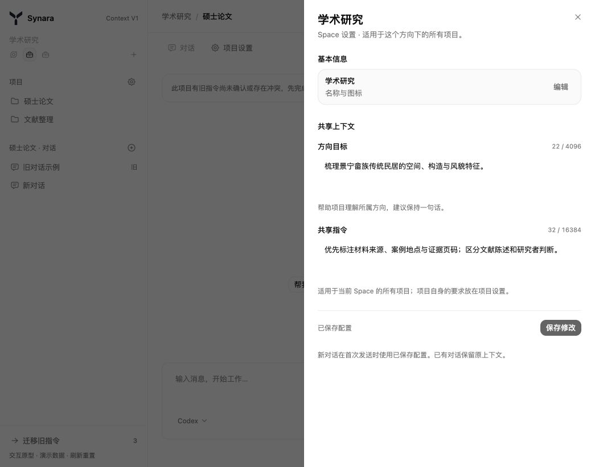
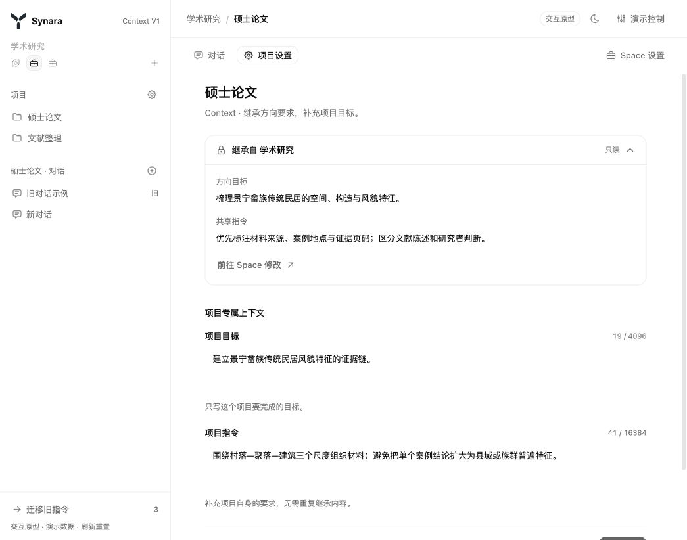
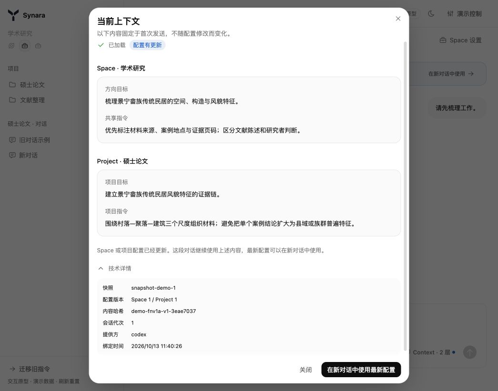
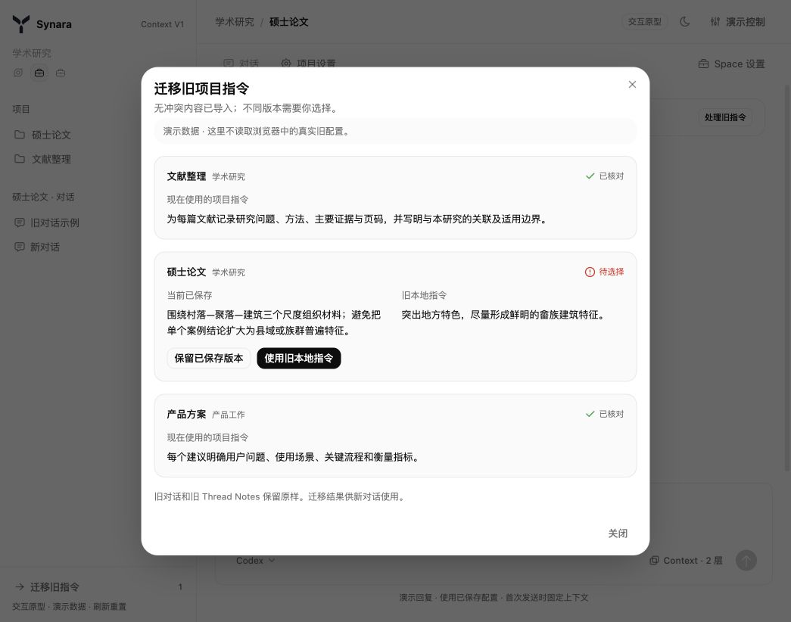

# Synara Space / Project Context V1 前端交互 PRD

版本：v0.1 · 评审稿  
日期：2026-10-13  
适用范围：Space、Project 与 Thread 的最小上下文配置、继承查看、固定内容展示及旧指令迁移。

本文沿用已确认的 Context V1 产品规则，以[可操作原型](http://127.0.0.1:17736/)为交互基准，供产品审核和正式前端接入使用。原型已完成演示与检查，尚未获得最终界面验收；服务端持久化和真实 Provider 加载尚未接入。原型验证情况见[验收记录](./acceptance-v1.md)。

## 1. 产品问题与目标

用户需要让同一工作方向的项目共享少量要求，同时保留项目自己的目标。当前改造需要解决三个问题：共享要求容易重复填写；用户难以判断一段对话真正使用了哪些内容；配置更新与旧对话之间缺少清晰边界。

本版让用户完成三件事：

1. 在 Space 设置共用的方向目标与指令，在 Project 补充自身目标与指令。
2. 在对话中查看上下文的来源、固定内容和加载结果。
3. 修改配置或迁移旧指令后，明确知道新对话与已有对话分别使用什么内容。

成功标准是用户能找到配置入口、区分继承和自身内容，并在出现失败或版本冲突时知道下一步操作。界面反馈必须与服务端确认的结果一致。

## 2. 本版范围与核心规则

| 本版交付        | 交互形态                               |
| --------------- | -------------------------------------- |
| Space Context   | 右侧设置面板，两个自由文本字段         |
| Project Context | 项目设置中的只读继承区与专属编辑区     |
| Thread Context  | 输入区轻量入口、只读详情、配置更新提示 |
| 保存异常        | 失败保留草稿、版本比较与明确选择       |
| 旧指令迁移      | 批次归属确认、无冲突导入、逐项冲突选择 |
| 适配与可访问性  | 主题、用户字号、窄屏、键盘和焦点返回   |

Hermes Owner、Memory、知识来源管理、独立 Context 管理中心、复杂继承开关、历史会话热替换以及新的 Expert 配置流程属于后续范围。

**必须保持的规则：**

- 四个配置字段以服务端已保存值为准。编辑草稿不参与对话执行。
- Space 共享内容在 Project 中只读；修改必须回到 Space。
- 普通新对话在首次有效发送请求中，由服务端固定 Context；前置校验被拒绝时不绑定快照。
- 已固定的对话内容不随源配置更新。Thread 不提供第三套可编辑的长期 Context。
- 保存配置与普通发送分别处理。发送不触发“保存／放弃／取消”草稿弹窗。
- 首次加载失败后，重试使用原消息和原快照，不重新选择最新配置。
- 历史对话沿用原有内容，不自动补入新 Context，也不自动清理旧 Thread Notes。
- 只有当前项目确有待认领、未完成或冲突的迁移数据，才限制其新对话首次发送；已有对话和其他项目不受全局限制。

本文中的 Thread 指现有产品的“对话”，不新增 Task / Run 实体划分。

本文的“新对话首次发送限制”针对尚未绑定 Context 的普通对话。已经继承固定快照或历史模式的同项目派生对话，按其既有绑定关系处理，不重新套用当前项目的新对话迁移限制。

## 3. 页面与入口

| 入口                                    | 打开内容                     | 关闭或返回                           |
| --------------------------------------- | ---------------------------- | ------------------------------------ |
| 工作区顶部“Space 设置”及 Space 编辑入口 | 当前 Space 的右侧设置面板    | 回到原工作区位置                     |
| 工作区顶部“项目设置”                    | 当前 Project 的设置内容区    | “对话”返回当前对话                   |
| Project 继承区“前往 Space 修改”         | 所属 Space 的右侧设置面板    | 回到原 Project 编辑区，保留项目草稿  |
| 输入区“Context”                         | 当前 Thread 的只读上下文详情 | 返回 Context 入口                    |
| 当前项目的旧指令提示“处理旧指令”        | 迁移确认与结果弹窗           | 返回触发位置                         |
| 迁移提示入口                            | 同一迁移弹窗                 | 窄屏导航被关闭时，返回“展开导航”按钮 |

Space 新建仍只要求名称与图标，Context 在创建后设置，两个字段初始为空。原型中的学术研究等文本是演示样本，不能作为正式创建时自动写入的默认指令。

项目设置采用原型中的内容区切换，复用现有 Project Instructions 能力。正式接入若需要调整入口位置，应审核入口变化，保持本文的字段、继承、保存和对话规则。

## 4. 字段定义

| 所属对象 | 字段     | 用途                              | 必填 | 上限         |
| -------- | -------- | --------------------------------- | ---- | ------------ |
| Space    | 方向目标 | 描述这个方向希望持续推进什么      | 否   | 4096 个字符  |
| Space    | 共享指令 | 适用于这个 Space 下所有项目的要求 | 否   | 16384 个字符 |
| Project  | 项目目标 | 描述这个项目希望达成什么          | 否   | 4096 个字符  |
| Project  | 项目指令 | 补充这个项目自身的要求            | 否   | 16384 个字符 |

全部使用多行文本输入，支持粘贴和换行。保留用户原文，不自动生成、分类、改写、合并或截断。允许清空后保存；查看态的空字段显示“未设置”。

目标字段占用较少空间，指令字段提供更大的编辑区域。字段旁显示当前长度与上限；超限时显示具体错误并禁用保存，已有内容仍保留。前后端必须采用同一字符计数口径，正式接口确定前以原型的字符串长度规则为联调参考，上限不变。

| 字段     | 提示文案                                                  |
| -------- | --------------------------------------------------------- |
| 方向目标 | 帮助项目理解所属方向，建议保持一句话。                    |
| 共享指令 | 适用于当前 Space 的所有项目；项目自身的要求放在项目设置。 |
| 项目目标 | 只写这个项目要完成的目标。                                |
| 项目指令 | 补充项目自身的要求，无需重复继承内容。                    |

## 5. Space 设置交互

面板从右侧打开，保留工作区背景，标题显示 Space 名称，说明为“Space 设置 · 适用于这个方向下的所有项目”。

内容顺序：基本信息 → 共享上下文 → 保存区 → 生效说明。基本信息中的名称与图标复用现有 SpaceEditorDialog；Context 区只包含方向目标和共享指令。

用户修改任一字段后，底部显示“有未保存的更改”，启用“保存修改”，出现“还原”。保存成功显示“修改已保存”；保留面板供继续查看，不自动跳转对话。未修改时显示“已保存配置”，保存按钮禁用。

固定说明为：“新对话在首次发送时使用已保存配置。已有对话保留原上下文。”Space 不展示或编辑各 Project 的专属字段。

## 6. Project 设置交互

设置页首先显示项目名称和简短说明，下方分为“继承内容”和“项目专属上下文”。

### 6.1 只读继承区

- 默认折叠，标题为“继承自 {Space 名称}”，带只读标识。
- 展开后显示方向目标、共享指令和“前往 Space 修改”。继承内容没有输入控件或覆盖开关。
- 从此处打开 Space 设置，不离开 Project 编辑区，也不丢弃项目草稿。
- Space 保存成功后，继承预览更新为最新已保存内容，项目草稿继续保留；已有 Thread 的固定内容不变。
- 未归入 Space 的项目显示“此项目尚未归入 Space，只使用项目自身的上下文”，不构造虚假的 Space 层。

### 6.2 专属编辑区

显示项目目标和项目指令，保存只影响当前 Project。继承内容不复制到项目字段中，保存项目也不回写 Space。保存、还原和离开保护沿用第 7 节的公共规则。

## 7. 保存、草稿与并发编辑

### 7.1 保存状态

| 状态           | 界面与操作                                              | 数据要求                               |
| -------------- | ------------------------------------------------------- | -------------------------------------- |
| 正在读取配置   | 显示加载反馈；编辑不可用                                | 不把空占位当成已保存的空配置           |
| 读取失败       | 显示错误和“重试”                                        | 不初始化空值并允许覆盖保存             |
| 已保存、未修改 | 显示已保存状态，保存禁用                                | 记录本次读取的配置版本                 |
| 已修改         | 显示未保存提示，启用保存与还原                          | 草稿独立于已保存配置                   |
| 正在保存       | 显示“正在保存…”，禁用重复保存与字段编辑，保持当前编辑区 | 不提前标记成功或丢弃草稿               |
| 保存成功       | 显示“修改已保存”，保存禁用                              | 使用服务端确认的字段和版本更新编辑基线 |
| 保存失败       | 显示错误，草稿保留，可重试                              | 原已保存配置不被前端假定覆盖           |
| 版本冲突       | 展示当前已保存内容与我的草稿                            | 不静默覆盖，不自动合并                 |

配置在其他位置更新时，没有草稿的编辑区可刷新；有草稿时保留本地编辑，保存需要校验原版本。版本校验使用服务端的条件保存机制，不凭前端显示内容推断成功。

保存结果因超时等原因不明确时，应先读取最新配置核对，再反馈成功、失败或冲突。用户不会因一次响应丢失而看到虚假的“修改已保存”。

### 7.2 版本冲突选择

标题：“内容在另一处更新了”。说明：“比较两个版本后选择；当前草稿尚未覆盖已保存内容。”

桌面并列展示“当前已保存”和“我的草稿”，分别列出目标、指令；窄屏上下排列并保留标题。

| 操作           | 结果                                                                     |
| -------------- | ------------------------------------------------------------------------ |
| 使用已保存版本 | 用最新服务端内容替换本地草稿，更新编辑基线，不写服务端                   |
| 保留草稿并保存 | 用户明确选择后，以最新版本重新提交草稿；再次冲突时继续保留草稿并重新比较 |

未做出选择前不允许普通保存绕过冲突处理。

### 7.3 离开编辑区

只有有未保存更改且将离开对应编辑区域时触发已有草稿保护：关闭 Space 面板、从项目设置返回对话、切换对象或页面。关闭窗口与刷新沿用浏览器/现有应用的离开保护，不创建另一套重复提醒。

| 选择       | 行为                                                             |
| ---------- | ---------------------------------------------------------------- |
| 取消       | 留在当前编辑区，草稿完整保留                                     |
| 放弃更改   | 放弃该编辑区草稿，随后执行原离开操作；不撤销其他位置已保存的配置 |
| 保存并继续 | 保存成功后执行原离开操作；失败或冲突时仍留在编辑区               |

从 Project 打开所属 Space 设置不算离开 Project。关闭这个 Space 面板只处理它自己的草稿，不顺带放弃 Project 草稿。普通发送始终使用已保存配置，不触发上述三选一。

## 8. Thread 上下文查看与执行反馈

### 8.1 输入区入口

在现有 ChatComposerFooter 中增加轻量 Context 入口，保留现有 Expert、运行方式、模型和发送控件。

- 常态显示“Context · 2 层”或“Context · 1 层”。层数表示来源层级，不表示内容多少；有 Space 即两层，未归入 Space 即一层。
- 悬浮提示显示来源名称和当前状态，技术编号不占用输入区。
- 已固定对话的源配置有变化时，增加轻量标记，详情中显示“配置有更新”。
- 历史模式显示“Context · 旧对话”。全部字段为空时，详情明确说明未配置 Synara Context，不能让用户误认为加载了非空指令。

### 8.2 只读详情

点击入口打开“当前上下文”弹窗。默认内容顺序为：当前状态 → Space 来源与两个字段（如有）→ Project 来源与两个字段 → 必要提示或操作 → 默认折叠的技术详情。

尚未首次发送时展示最新已保存配置的预览；发送前的并发更新以服务端最终绑定内容为准。固定后只展示该 Thread 的快照副本，不能用当前设置值替代。

读取固定内容失败时显示“上下文详情暂不可用”和重试入口，不回退展示当前设置来假装恢复了历史快照。会话未运行时可标注“上次已加载”及记录时间；恢复开始后必须等待当前会话的确认。

技术详情包含快照标识、来源版本、内容哈希、Provider、会话代次和绑定时间。界面不能把 Context 快照与不断变化的加载记录混成同一个可编辑对象。Provider 的原生文件指令可能另行加载，不能将四字段详情宣传为模型接收的全部上下文。

### 8.3 状态与操作

| Thread 状态                       | 展示                                       | 可操作项                                                  |
| --------------------------------- | ------------------------------------------ | --------------------------------------------------------- |
| 新对话、待首次发送                | 已保存配置预览；“首次发送时固定已保存配置” | 编辑源配置、按既有规则选择运行配置、发送                  |
| 首次发送被前置校验拒绝            | 明确原因；输入草稿保留                     | 处理当前项目迁移、选择支持的运行方式或重试读取            |
| 固定后正在加载                    | “正在加载此对话的上下文…”                  | 查看固定内容；禁用重复发送与重复重试                      |
| 加载确认成功                      | “已加载”；显示固定内容                     | 正常继续对话、查看详情                                    |
| 固定后加载失败                    | “上下文加载失败，消息尚未执行”             | 按原上下文重试；保留原用户消息且不生成成功回复            |
| 恢复或连接后等待确认              | 等待加载/状态确认的反馈                    | 不依据旧成功记录宣称当前会话已加载                        |
| 所需 Context 不被所选运行方式支持 | 明确拒绝原因，不显示加载成功               | 保留消息与固定快照，按现有运行配置/接续规则选择支持的方式 |
| 旧对话                            | 沿用历史内容；不补入新 Context             | 继续旧对话、在新对话中使用最新配置                        |

“已加载”必须由服务端确认 Provider 应用结果后显示，不能只因存在快照或请求已发送就显示。“消息尚未执行”同样需要服务端明确确认；结果不明确时显示等待确认，不鼓励用户盲目重复提交。

加载失败时，重试复用原消息和原快照，只更新加载状态与会话代次。即使源配置在失败期间更新，也不重新绑定最新值；已有固定对话的重试不受新对话迁移限制影响。

### 8.4 配置更新与新对话

已固定对话的四字段内容或来源归属变化时提示：“配置有更新 · 这段对话继续使用原上下文。”仅有版本递增而内容、来源相同时不提示；单纯改名或换图标不作为 Context 内容更新。

“在新对话中使用”创建同一项目下的空白新对话，沿用现有新建对话的运行配置默认规则。新对话在自己的首次发送时固定最新已保存配置，不自动重发旧消息、不复制历史会话来假装使用了新 Context。

Space 删除或 Project 更换 Space 后，已有快照仍可读；未来新对话按新归属配置。详情中的绑定来源与当前归属可以不同，不静默替换历史内容。

### 8.5 与 Expert、Provider 及派生对话的关系

- Context 设置不编辑 Expert Persona、Skills 或模型配置，也不覆盖专家选择入口。指令合成由执行侧负责，前端根据确认结果展示加载状态。
- Context V1 首期目标为 Codex / Pi，当前原型仅模拟二者。正式前端依据服务端可用性判断；非空 Context 在不支持的运行方式下限制启动与恢复，并说明原因。尚未绑定时检查待绑定配置；已绑定或继承快照时检查该固定快照，不能改用最新配置绕过限制。这不新增原对话内部热切换 Provider 的入口。
- 四字段全空时，按既有 Provider/Expert 规则工作，不能仅因 Context V1 的支持范围阻断原有能力。
- 同一 Project 的 fork/handoff：来源已绑定时继承固定 Context；来源为历史模式时继承历史模式；来源是尚未绑定的普通对话且既有能力允许派生时，在派生对话自己的首次有效发送中绑定。派生能力是否可用仍沿用既有规则。想在已固定对话之外使用新配置，应新建普通对话。
- 跨 Project 派生沿用既有禁止规则，不提供携带旧 Space Context 的变通入口。
- 历史模式由服务端识别，不能靠消息数量、页面是否为空或前端版本猜测。

## 9. 旧项目指令迁移

### 9.1 发现与归属确认

仅在发现本功能对应的旧本地项目指令时展示迁移提示。有相关数据的当前项目，可在聊天或项目设置进入“处理旧指令”；批次处理使用同一个弹窗，不另建一级管理页面。

弹窗先列出目标项目、所属 Space 和旧指令摘要，用户点击“确认属于当前工作区并迁移”后才允许写入。前端不能仅凭旧 Project ID 相同，就静默认定数据属于当前服务端或工作区。切换工作区后需重新校验归属。

无历史数据的用户不经过迁移流程。迁移可以稍后处理，但待处理项目自己的新对话首次发送仍受限制；其他项目与既有对话继续可用。

### 9.2 处理结果

| 条件或状态                 | 处理与反馈                                                   |
| -------------------------- | ------------------------------------------------------------ |
| 待认领                     | 只展示待确认信息，不写入服务端                               |
| 当前已保存项目指令为空     | 归属确认后安全导入旧指令，保留当前项目目标                   |
| 当前指令与旧指令完全相同   | 核对后标记完成，不重复生成配置版本                           |
| 两份非空内容不同           | 标为“待选择”，并列比较两个指令版本                           |
| 保存失败或结果未确认       | 旧内容保留，显示未完成原因，提供重试；不标记成功             |
| 处理期间当前项目又发生更新 | 更新比较依据，再由用户选择；不静默覆盖                       |
| 完成并回读核对             | 显示“已核对”，不再阻断该项目的新对话；后续进入不重复要求认领 |

冲突只比较和选择项目指令：

- **保留已保存版本**：保留当前服务端指令，核对当前版本后完成本条迁移。
- **使用旧本地指令**：按最新版本条件保存旧指令，保留项目目标；保存和回读一致后完成。

批次可部分完成。一条记录失败或有冲突，不回滚其他已核对记录；每条结果清楚显示。关闭弹窗不等于完成未处理记录。

迁移不重写旧 Thread Notes，也不自动清理此前复制到历史会话中的指令。正式产品的迁移完成状态必须能跨重启恢复，不能沿用原型的内存状态作为完成依据。

## 10. 视觉、键盘与窄屏要求

- 复用 Synara 的按钮、文本输入、Sheet、Dialog、Popover、Tooltip、设置区域、主题和图标；Context 业务组件以这些能力组合。
- 正文、说明、状态和输入跟随用户在 Settings 选择的字体与字号。保留真实字号 token，不另设一套固定小字体系。
- 折叠与展开复用现有 disclosureMotion，保留减少动画偏好的支持。
- 打开弹层时焦点进入其中，Tab 顺序覆盖字段和操作，不穿透底层页面；关闭后返回调用入口。入口已随导航关闭时，返回仍可用的导航按钮。
- 只读继承可用键盘展开，所有字段有标签，错误有文字说明；状态不能只用颜色或小点表达。
- 窄屏保留 Space/Project/Thread 切换，导航采用现有左侧 Sheet；Space 设置采用右侧 Sheet，长内容可滚动。保存、关闭和重试控件必须可达。
- 冲突比较在窄屏上下排列，来源标题不能丢失。长文本换行，不造成页面横向滚动。
- 实机验收需覆盖浅深色、最小/最大字号、窄屏和输入法键盘；不能用桌面缩小窗口替代移动键盘遮挡检查。

## 11. 前后端联调边界

| 前端负责           | 需要服务端/执行侧提供                                        |
| ------------------ | ------------------------------------------------------------ |
| 展示与编辑草稿     | 具有来源标识、字段和版本的权威配置                           |
| 保存反馈与冲突比较 | 按版本条件保存、冲突最新值、保存确认和可核对结果             |
| 首次发送前的提示   | 当前项目迁移状态、Provider 可用性与明确拒绝原因              |
| 展示固定内容       | Thread 的独立快照及来源信息，不能只返回当前配置              |
| 展示加载/重试反馈  | 独立应用记录、当前会话状态、代次、失败原因及原请求处理状态   |
| 配置更新标记       | 内容与来源变化结果，或足以可靠比较的字段；不能只按版本号判定 |
| 历史与派生模式     | 服务端判定的历史标记、来源快照及派生限制                     |
| 迁移确认与结果列表 | 归属确认后的条件写入、逐条结果、回读与持久完成状态           |

正式发送不传前端草稿作为执行上下文；服务端负责固定配置、与 Expert 组合并交给对应 Provider。页面切换和工作区切换后，不复用另一对象的草稿、来源预览或迁移归属。

API 字段名、错误码、持久化结构、事务边界和原生注入实现另在技术方案中确定。本 PRD 约定产品语义，不以演示适配器的类型或哈希算法作为生产契约。

## 12. 验收标准

P0 覆盖内容正确性、保存可靠性与执行边界；P1 覆盖入口、呈现和可访问性。正式接入须依据真实服务端状态完成验收，不能把原型 mock 结果算作生产通过。

| 编号 | 优先级 | 操作场景                                                      | 预期结果                                                                                      |
| ---- | ------ | ------------------------------------------------------------- | --------------------------------------------------------------------------------------------- |
| F01  | P1     | 新建 Space                                                    | 名称、图标即可完成，Context 初始为空                                                          |
| F02  | P1     | 打开 Space/Project 设置                                       | 对象清楚，字段与继承来源正确                                                                  |
| F03  | P0     | 编辑项目中的继承区                                            | 只能查看；进入 Space 修改不丢项目草稿                                                         |
| F04  | P0     | 保存成功后重新打开或重启                                      | 显示已保存内容，读取失败不伪装为空配置                                                        |
| F05  | P0     | 字段超限或保存失败                                            | 明确报错，不截断、不清空草稿、不显示成功                                                      |
| F06  | P0     | 两个编辑入口并发修改后保存                                    | 条件保存拒绝旧版本，必须比较并选择                                                            |
| F07  | P0     | 离开有草稿的编辑区                                            | 取消保留；放弃离开；保存成功才继续                                                            |
| F08  | P0     | 普通发送时存在其他编辑草稿                                    | 使用已保存配置，不弹保存三选一                                                                |
| F09  | P0     | 配置在首次发送前并发更新                                      | 详情显示服务端实际固定内容，不使用过时前端预览                                                |
| F10  | P0     | 已固定后更新 Space/Project                                    | 原内容不变，有实际内容/来源变化才提示更新                                                     |
| F11  | P0     | 点击“在新对话中使用”                                          | 新建同项目空白对话，首次发送使用最新配置，不自动重发                                          |
| F12  | P0     | 首次加载失败，更新源配置后重试                                | 原消息、原快照保留；代次更新，无重复执行或回复                                                |
| F13  | P0     | 断网、快照读取失败、恢复或加载记录尚未确认                    | 显示读取失败/等待确认，不用当前配置替代快照，不从旧记录推断当前已加载                         |
| F14  | P0     | 非空 Context 配合不支持的 Provider，或携带该固定快照启动/恢复 | 启动或恢复被拒绝，消息与固定快照保留，原因可见；不破坏空 Context 的既有能力                   |
| F15  | P0     | 继续旧对话或同项目派生                                        | 分别继承历史模式/固定快照；来源尚未绑定且允许派生时在自身首次有效发送绑定；跨项目派生仍被禁止 |
| F16  | P0     | 删除 Space 或调整 Project 归属                                | 历史快照可读；新对话按新归属处理                                                              |
| F17  | P0     | 首次发现旧指令                                                | 未确认归属不写入；只限制相关项目新对话                                                        |
| F18  | P0     | 迁移空配置、相同内容、冲突和保存失败                          | 分别导入、核对、待选择、保留待重试；目标和旧 Notes 不被覆盖                                   |
| F19  | P0     | 迁移期间并发更新并重启                                        | 不静默覆盖；确认后的完成结果持久、不重复迁移                                                  |
| F20  | P1     | 11–18px 字号、浅深色、390px 窄屏                              | 标签、内容、保存、关闭和重试可读可达，无横向溢出                                              |
| F21  | P1     | 键盘展开、弹层打开/关闭、窄屏迁移                             | 可完整操作；关闭返回正确入口，不能落到不可见对象                                              |
| F22  | P0     | 同时使用 Expert 与 Context                                    | 专家配置和四字段均保留，加载反馈来自真实确认结果                                              |

## 13. 原型覆盖与正式接入清单

原型已演示：设置与继承、草稿保护、保存失败/冲突、首次固定、源更新提示、新对话、原快照重试、历史模式、迁移、Provider 提示、主题/字号/窄屏及焦点返回。原型界面的“演示控制”仅用于审核，正式产品不保留故障模拟入口。

正式接入还需补齐并验证：

1. 服务端配置读取、保存、版本冲突、事件更新以及重启后的恢复。
2. 真实首次绑定、Provider 应用记录、断网/恢复及结果不明确时的反馈。
3. 旧本地配置识别、工作区归属、条件迁移与持久完成状态；没有迁移数据时隐藏不必要提示。
4. 全空 Context 的清楚说明、真实能力判断、Space 删除/归属变化、同项目派生和 Expert 并行使用。
5. 移动输入法键盘、系统减少动画偏好、实际生产布局及本地化。

本稿补充的配置初次读取失败、结果等待确认、迁移完成持久化和全空说明等状态属于正式产品需求，当前演示不证明这些状态已经接入。

产品审核重点为四个页面入口、信息层级、保存/冲突操作、Context 详情文案和迁移确认负担。审核通过后，再按联调依赖接入正式前后端；不将原型检查结果等同于生产验收。

## 14. 参考材料

- [可操作原型及启动说明](../README.md)
- [原型验收记录](./acceptance-v1.md)
- [视觉与交互 QA](./design-qa-v1.md)
- [Linx 产品设计 V2.0](../../../../docs/linx-product-design-v2.md)：上层产品方向，Context V1 是本次最小范围。
- [Expert 产品与技术方案](../../../../docs/expert-product-technical-design.md)：既有 Expert、Provider 和快照约束，不能由本稿推定已实现新的合成链路。
